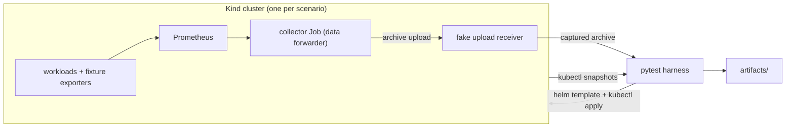

# Kubex Stack E2E

End-to-end tests for the Kubex Automation Stack's data collector. This page is for developers who run
the tests, read their results, or change them.

Each scenario creates a Kind cluster with a known shape and installs the stack with Helm. It then
captures the CSV archive the collector uploads and checks every value against what Kubernetes or a
fixture says is true. Scenarios are pytest modules under [`scenarios/`](scenarios/). The harness that
runs them is under [`harness/`](harness/).



## Quickstart

You need Docker, `kind`, `kubectl`, `helm` and Python 3. CI pins the exact versions in
[`.github/workflows/kind-functional.yaml`](.github/workflows/kind-functional.yaml).

```sh
python3 -m venv .venv && .venv/bin/pip install -r requirements.txt
.venv/bin/python -m pytest tests -q                                   # unit tests, no cluster
.venv/bin/python -m pytest scenarios/node-pressure -v --tb=short      # one scenario, live Kind cluster
```

Scenario run options (defined in [`conftest.py`](conftest.py)):

| Option | Effect |
| --- | --- |
| `--collector-image IMAGE` | Collector to test. Default: the scenario spec, else the chart's default image. |
| `--stack-chart-version X.Y.Z` | Chart version. Default: the latest stable version. |
| `--replay DIR` | Re-run the assertions against a previous run's artifact directory. No cluster is created. |
| `--keep-cluster` | Leave the Kind cluster running after the run. |
| `--artifacts-root DIR` | Where artifacts go. Default: `artifacts/kind-functional`. |
| `-m pr` / `-m "pr or release"` | Test tier. Every scenario is currently `pr`. |

### Replay a run

Replay rebuilds the run from saved artifacts and runs the tests in under a second. Use it to debug a
red CI run or to iterate on an assertion.

```sh
gh run download <run-id> -n kind-functional-<scenario>-<run-id> -D /tmp/<scenario>
.venv/bin/python -m pytest scenarios/<scenario> --replay /tmp/<scenario> -q --tb=short
```

### Run in CI

The `kind-functional` workflow runs on pushes to `anant/stack-e2e-harness` and on manual dispatch:

```sh
gh workflow run kind-functional.yaml --ref <branch> \
  -f scenario=container-resources -f tier=pr \
  -f stack_chart_version= -f collector_image=densify/container-optimization-data-forwarder:<tag>
```

| Input | Default |
| --- | --- |
| `scenario` | blank: every directory under `scenarios/` |
| `tier` | `pr` (`release` runs `pr or release`) |
| `stack_chart_version` | blank: latest stable chart |
| `collector_image` | blank: the chart's default collector |

## Reading a red run

Start at the run page. The `Run summary` job finishes last and owns it: the annotations box lists an
**E2E run summary** headline (failed and passed counts, chart and collector versions) and one
failure group per scenario, each pointing at the failing line. Below it, the job summary has one row per scenario
(status, passed, failed, setup errors, a link to its doc) and a collapsible failure table per scenario.
Scenario jobs stay red but write no summary. Their artifact still holds `summary.md` and `failures.md`.
GitHub adds its own "Process completed with exit code 1" error for each red scenario job. The report job
stays green when it wrote the summary, so a red run means at least one scenario job is red. The prefix of a failure tells you whose problem it is:

| You see | Meaning | What to do |
| --- | --- | --- |
| A plain assertion headline, e.g. `node/cpu_request.csv ... at <time> — assert actual 1500.0, expected 1250.0` | The collector disagrees with Kubernetes or fixture truth. This is a collector finding. | Replay, read the test's truth source, confirm, then report it against the collector. Do not change the test to match. |
| `[setup error] ...` | The run never reached the tests: cluster, Helm, Prometheus readiness or the forwarder Job failed. | Check `summary.md` and `diagnostics/` in the artifact. |
| `[call error] ...` | A test raised something other than an assertion, such as a `KeyError` or `OracleDrift` (the cluster changed during the window). | Treat it as a harness or test bug, or as an unstable cluster. |
| Warning **Coverage review needed** | The collector emitted a CSV or column that the [coverage inventory](harness/coverage.py) does not list. | Classify it. See [docs/extending.md](docs/extending.md#update-the-coverage-inventory). |
| `archive differs from the coverage inventory` | A known column was lost, renamed or reordered. | This is an error. Confirm the change in the collector first. |

Tests assert the correct value and stay red until the collector is fixed. The suite has no `xfail`,
and no test is changed to work around a collector defect.

## Documentation

| Doc | Read it to |
| --- | --- |
| [docs/architecture.md](docs/architecture.md) | Understand the data flow, the run lifecycle, the artifacts, replay, the coverage inventory and the CI matrix. |
| [docs/architecture.md#scope-and-limits](docs/architecture.md#scope-and-limits) | See what the suite does not prove. |
| [docs/scenarios/README.md](docs/scenarios/README.md) | See what each scenario proves, at a glance. |
| [docs/scenarios/container-resources.md](docs/scenarios/container-resources.md) | Read a full scenario walkthrough (the exemplar). |
| [docs/scenarios/_template.md](docs/scenarios/_template.md) | Write a doc for a new scenario. |
| [docs/extending.md](docs/extending.md) | Add a scenario, test or fixture, update the inventory, bump versions. |
| [AGENTS.md](AGENTS.md) | Conventions and context tips for coding agents (also useful for humans). |

## Legacy stack-validation workflow

[`stack-validation.yml`](.github/workflows/stack-validation.yml) is an older, separate load check. It
runs on pushes to `main`, nightly at 02:00 UTC, and on manual dispatch. It creates a Kind-backed KWOK
cluster and scales to 100 simulated nodes. It applies 25 Deployments, 25 StatefulSets, 10 CronJobs and
one DaemonSet, then waits 30 minutes. After that it runs the forwarder and checks that the required
cluster, node and container CSVs have rows. Its versions are fixed in the workflow: chart `1.0.18`,
KWOK `v0.5.1`, Kubernetes `v1.30.0`, Helm `v3.16.3`. Its code is
[`scripts/build_stack_validation_workloads.py`](scripts/build_stack_validation_workloads.py),
[`scripts/validate_stack_upload.py`](scripts/validate_stack_upload.py) and
[`scripts/summarize_stack_validation.py`](scripts/summarize_stack_validation.py). It shares the fake
receiver with the harness.
