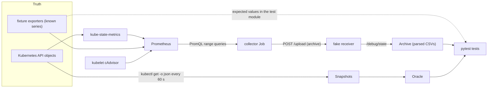
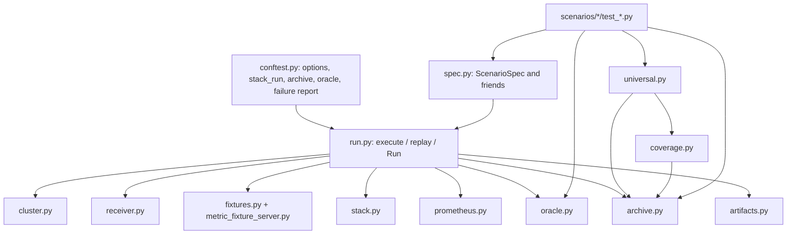
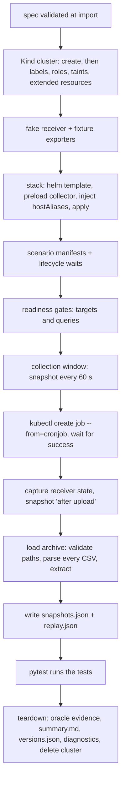
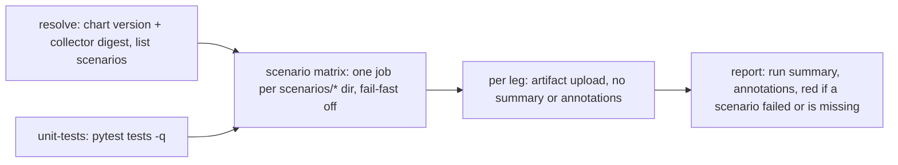

# Architecture

How the harness turns a scenario spec into a pass or a fail. For developers who change the harness or
need to know where a value comes from.

## The data path under test

The **collector** is the `container-optimization-data-forwarder` image. One run of it:

1. Queries Prometheus with PromQL range queries over `[AuditTime - interval, AuditTime]`, one sample
   per `sample_rate` minutes. The series come from kube-state-metrics (inventory, requests, limits,
   owners, quotas, HPAs), kubelet cAdvisor (container usage), node exporter (node usage) and optional
   exporters (DCGM, the Kubex GPU exporter, Beyla, the ephemeral-storage exporter).
2. Writes one CSV per entity and metric (`cluster/`, `node/`, `node_group/`, `container/`, `hpa/`,
   `rq/`, `crq/`) plus `log.txt`, and packs them into one archive under the prefix `data/<cluster>`.
3. Uploads the archive over HTTP to the Kubex endpoint `/upload` (the **forwarder** part).

The harness changes only the upload target. The chart is rendered with the upload host
`fake.kubex.ai:8080`. [`scripts/inject_host_aliases.py`](../scripts/inject_host_aliases.py) then adds
a `hostAliases` entry that resolves that name to the in-cluster **fake receiver**
([`scripts/fake_stack_webserver.py`](../scripts/fake_stack_webserver.py)). The receiver records every
request body. Everything upstream of the upload is the real stack.

Tests compare the archive (actual) with snapshots, the oracle and fixture definitions (expected).
Collector output is never the source of an expected value.

## Components

| Module | Responsibility |
| --- | --- |
| [`conftest.py`](../conftest.py) | CLI options, the `stack_run` factory, the `archive` and `oracle` fixtures, `actual`/`expected` assertion diffs, failure headlines and `failures.md`/`failures.json` in CI. |
| [`harness/spec.py`](../harness/spec.py) | Frozen dataclasses: `ScenarioSpec`, `ClusterSpec`, `Node`, `StackSpec`, `ForwarderSpec`, `Collection`, `FixtureService`, `Metric`, `PrometheusSpec`, `Wait`. Validated at import, before any cluster work. |
| [`harness/report.py`](../harness/report.py) | CI run roll-up: reads every scenario artifact, writes the job summary and the annotations, exits non-zero if a scenario failed or is missing. |
| [`harness/run.py`](../harness/run.py) | `execute()` drives one run. `replay()` rebuilds a `Run` from artifacts. `Run` is what tests receive. |
| [`harness/cluster.py`](../harness/cluster.py) | Renders the Kind config, creates and deletes the cluster, applies node labels, roles, taints and extended resources. |
| [`harness/receiver.py`](../harness/receiver.py) | Deploys the fake receiver, reads its state, strips credentials, picks the archive body. |
| [`harness/fixtures.py`](../harness/fixtures.py), [`harness/metric_fixture_server.py`](../harness/metric_fixture_server.py) | Deploy one Deployment and Service per `FixtureService`, serving the typed `Metric` series (gauges fixed, counters grow at `rate` per second). |
| [`harness/stack.py`](../harness/stack.py) | `helm template` with harness defaults, collector preload, host alias injection, `kubectl apply`, forwarder Job trigger. |
| [`harness/prometheus.py`](../harness/prometheus.py) | Readiness gates: declared targets are up and every `PrometheusQuery` returns at least `min_results` series. |
| [`harness/oracle.py`](../harness/oracle.py) | `Snapshot`s and the `Oracle`: requests, limits, capacity, reservation percent and pod count per node selector, with drift detection across snapshots. |
| [`harness/archive.py`](../harness/archive.py) | Safe ZIP/TAR extraction, strict CSV parsing (`Csv`, `Archive`), and assertion helpers: `assert_metric_grid`, `expected_timestamps`, `row_label`, `label_map`, `prometheus_labels`, `assert_log_clean`. |
| [`harness/coverage.py`](../harness/coverage.py) | `INVENTORY` of every CSV and column the collector can emit, and `check_archive`. |
| [`harness/universal.py`](../harness/universal.py) | Five tests every scenario imports. |
| [`harness/artifacts.py`](../harness/artifacts.py) | Artifact directory, diagnostics, `summary.md`, the failure digest. |
| [`harness/command.py`](../harness/command.py) | `run`/`kubectl` wrappers and `HarnessError`. |
| [`harness/versions.py`](../harness/versions.py) | Pinned Kind node image and fixture image. The chart defaults to the latest stable version and the collector to the chart default. |

## Run lifecycle

`execute()` in [`harness/run.py`](../harness/run.py) runs once per scenario module. The session-scoped
`run` fixture enters it, all tests share the result, and teardown always runs.

Details that matter when you read results:

- **Collector image.** The order is `--collector-image`, then `StackSpec.collector_image`, then the
  chart default. It is pulled and loaded into Kind under a local tag, and the forwarder runs it with
  `imagePullPolicy: Never`, so the tested image is exactly the one that was resolved.
  `helm_overrides` cannot set the image.
- **Harness chart defaults.** Optional subcharts are disabled, the upload URL points at the receiver,
  and the CronJob schedule never fires. The forwarder runs only when the harness creates a Job from it.
- **Window.** It lasts `ForwarderSpec.window_seconds`, or `interval_size * interval + 10 s` when that
  is unset. Readiness gates happen before it, so the window holds only warm series.
- **No mutation in the window.** The harness changes nothing after readiness. Snapshots run on a
  fixed 60 s cadence. Oracle queries fail with `OracleDrift` if a value differs between snapshots.
  Churn that a scenario designs into its workload, such as a CronJob, is captured by the snapshots and
  asserted from them.
- **Grid.** `expected_timestamps(AuditTime, collection)` gives the exact `MetricTime` steps the
  collector must emit. `assert_metric_grid` checks the identity set and the steps per identity.

## Artifacts

One directory per scenario: `artifacts/kind-functional/<scenario>/`. CI uploads it as
`kind-functional-<scenario>-<run-id>`.

| Path | Content | Replay needs it |
| --- | --- | --- |
| `extracted-csv/` | The uploaded archive, extracted (CSVs and `log.txt`) | yes |
| `snapshots.json` | Every Kubernetes snapshot (nodes, pods, `snapshot_resources`). Large. | yes |
| `replay.json` | Upload count, Job name, Job failures | yes |
| `summary.md` | Versions and run facts. CI adds the pytest status. | |
| `versions.json` | Chart, requested image, digest, image ID on the node, collector version | |
| `kubernetes-oracles.json` | Every oracle query a test made, with its inputs and expected value | |
| `server-state.json` | The receiver's captured requests, credentials removed | |
| `prometheus-targets.json`, `prometheus-queries.json` | Readiness evidence | |
| `kind-config.yaml`, `kubex-stack-rendered.yaml`, `fixture-inputs/` | What was applied | |
| `diagnostics/` | Pods, events, nodes, EndpointSlices, forwarder Job and logs, per-pod logs | |
| `pytest.xml`, `failures.md`, `failures.json` | CI only: JUnit report, the failure table, and the `(test, file, line, message)` failures the roll-up reads | |

## Replay

`--replay DIR` skips the cluster entirely. `replay()` reads `snapshots.json`, `replay.json` and
`extracted-csv/` from DIR, builds the same `Run` (the oracle comes from the snapshots) and never writes to DIR.

This only works if tests read nothing but the `Run`: `run.archive`, `run.oracle`, `run.snapshots`
and the scenario constants. A test that calls `kubectl` or Prometheus would pass live and break on
replay.

## Coverage inventory and universal checks

[`harness/coverage.py`](../harness/coverage.py) lists every CSV path the collector can emit with its
exact header. Each column is classified as one of:

| Value | Meaning |
| --- | --- |
| `key` | Identity or time column (`KEYS`) |
| `test:<path>::<function>[,...]` | The tests that assert this column |
| `excluded:<reason>` | Cannot be asserted on Kind, with the reason |
| `unclassified` | No test asserts it yet |

A unit test in [`tests/test_collection_checks.py`](../tests/test_collection_checks.py) checks that
every `test:` reference resolves to a `def` in the named file.

Every scenario module runs `from harness.universal import *`, which adds these tests:

| Test | Asserts |
| --- | --- |
| `test_single_upload` | The receiver captured exactly one archive upload. |
| `test_job_never_failed` | The forwarder Job had no failed pod attempts. |
| `test_log_is_clean` | `log.txt` has no Prometheus query failures. "No data" skips pass. |
| `test_archive_matches_inventory` | No inventory column was lost, renamed or reordered (error). New CSVs or columns become warnings. |
| `test_expected_files` | The archive's inventory CSVs are exactly `ScenarioSpec.files`, each `populated` or `header-only` as declared. |

Warnings go into `summary.md`. The run roll-up lists them once and emits one annotation titled **Coverage review needed**.

## CI

[`.github/workflows/kind-functional.yaml`](../.github/workflows/kind-functional.yaml):

- `resolve` runs [`scripts/resolve_versions.py`](../scripts/resolve_versions.py) once and pins the
  collector to a digest, so every leg tests the same chart and image.
- Each leg runs `pytest scenarios/<name> -m <tier>` with both versions passed explicitly and a
  30-minute timeout. `conftest.py` writes `failures.md` and `failures.json` next to the artifact. A red
  leg stays red but writes no job summary and no annotation.
- `report` runs after the matrix (`needs`, not cancelled, so it also runs when legs failed). It downloads
  every `kind-functional-*-<run-id>` artifact and runs `python3 -m harness.report artifacts <scenario>...`.
  The artifacts are read as follows:

  | Input | Gives |
  | --- | --- |
  | `pytest.xml` | Passed and failed counts. |
  | `failures.json` | Failures, grouped by identical message as in `failures.md`. Messages starting `[setup error]` or `[call error]` count as setup errors. |
  | `summary.md` | The stack-run state (a scenario without `collected` is a setup error) and the coverage warnings. |
  | `versions.json` | Chart and collector versions. The headline notes when they differ between scenarios. |

  A scenario without an artifact is `no artifact`. The job writes the only job summary (headline, one row
  per scenario in matrix order, a `
` failure table per scenario, coverage warnings) and at most 10
  `::error` annotations: the headline, the largest failure groups, then `N more failures`. Coverage
  warnings are one `::warning`. GitHub adds one "Process completed with exit code 1" per red leg.

## Scope and limits

What the suite does not prove, across all scenarios. Each scenario doc lists its own gaps under "Not
covered".

- **No change in the window.** No hook changes the cluster after readiness. Tests use steady states and
  cadences, such as a crash loop or a churn CronJob. A rolling update or a kube-state-metrics restart in
  the window is not tested.
- **One bad row per file.** A per-row loop stops at the first bad timestamp. The full CSV is in
  `extracted-csv/`.
- **No independent truth.** Columns marked `excluded:` in [`harness/coverage.py`](../harness/coverage.py)
  give their reason. The cAdvisor working set is one: its grid is checked, not its values.
- **Environments Kind cannot reproduce.** Cloud providers, OpenShift (`crq/` files, `count/pods` quotas,
  machine-set node groups with cluster identifiers), real NVIDIA hardware and KWOK-scale clusters.
- **Silent query failures.** A failing workload query writes no line to `log.txt`, so `test_log_is_clean`
  cannot see it. A missing file shows up in `test_expected_files`.
- **Red tests stay red.** The repo keeps no list of known-failing tests.
- **Reporting.** CI has no third-party JUnit reporter. The run roll-up reads only what a leg uploaded, so a
  leg that never uploaded shows as `no artifact` without a reason.
