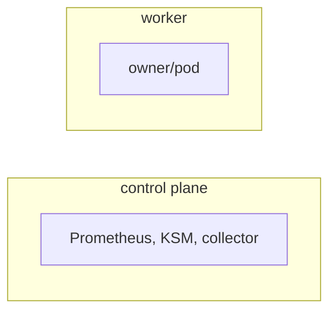

# <scenario-name>

<!--
Copy to docs/scenarios/<scenario-name>.md and link it from docs/scenarios/README.md.
Keep it under ~200 lines. Facts come from the scenario module and workload.yaml; grep every name you
mention. Never list which tests currently fail. Delete these comments.
-->

<One or two lines: what collector behaviour this scenario proves, and who should read this page.>

Code: [`test_<scenario_name>.py`](../../scenarios/<scenario-name>/test_<scenario_name>.py), [`workload.yaml`](../../scenarios/<scenario-name>/workload.yaml)

## Purpose

<Three to five bullets. Each says one collector behaviour and why this setup can catch it breaking.>

## Setup

| Item | Value |
| --- | --- |
| Cluster | <control plane + N workers, labels, roles, taints, kubelet settings> |
| Workloads | <owners in workload.yaml, namespaces, where they are pinned> |
| Fixtures | <FixtureService names and what they stand in for, or "none"> |
| Collector settings | <Collection(interval, interval_size, history, sample_rate) and notable helm_overrides> |
| Window | <window_seconds> |
| Readiness gates | <the PrometheusQuery names that must hold before the window> |
| Snapshots | <snapshot_resources beyond nodes and pods> |

## What the collector collects

<!--
One block per data family the scenario exercises (archive file family, e.g. node/attributes.csv
labels, node_group/* membership, container/* requests, *_utilization series). Skip families that are
only grid or shape checks. About 20-40 lines in total.
-->

### <Family, e.g. node_group/ membership>

<One or two lines: the Prometheus or kube-state-metrics series the collector queries (named as in
the collector source or the test docstrings), and what a resulting row means.>

<Tiny example: input state, then the rows that result. Use small tables or a short CSV excerpt with
only the relevant columns and "..." for the rest. Show the CORRECT output, as the tests expect it,
derived from the scenario's truth. Copy column names and value formats from a real archive. Use short
names (worker, worker2) and state the units the tests assert.>

## Truth sources

| Source | Used for |
| --- | --- |
| Kubernetes snapshots (`run.snapshots`, `oracle.primary`) | <which fields> |
| Oracle (`oracle.requests` / `limits` / `capacity` / `reservation_percent` / `pod_count`) | <which totals> |
| Fixture series (`Metric` definitions in the module) | <which usage values> |

## Tests

Group the tests by area (archive directory or behaviour). One row per test function, not per
parametrized case.

### <Area, e.g. container/>

| Test | Asserts | Truth | A failure means |
| --- | --- | --- | --- |
| `test_<name>` | <what is compared> | <snapshot / oracle / fixture / grid> | <collector behaviour that is wrong> |

Truth is `snapshot`, `oracle`, `fixture`, `grid` or `log`, or a named constant in the module.

Premise tests, which check the cluster rather than the collector, go in their own group. A failure
there means the setup did not produce the state the other tests assume.

## Not covered

<!--
Two to six bullets. Each gives the gap and why: a deliberate choice, impossible on Kind, or no
independent truth. Describe behaviour in plain words. Leave the whole section out if nothing applies.
-->

- <What the suite does not check, and why.>

## Extend

- <Where to add a workload or series and which constants to update.>
- Follow [extending.md](../extending.md) for the general steps.
