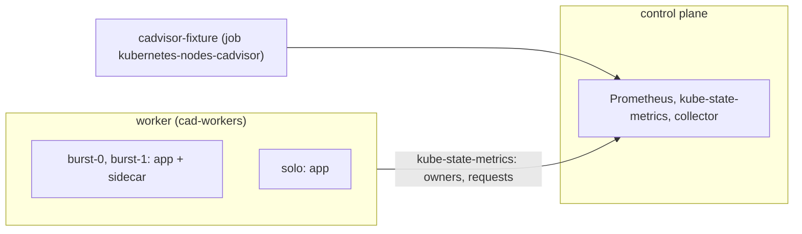

# cadvisor

Proves the collector reads container CPU, memory, disk and throttling usage from cAdvisor-shaped series, including the two custom sizing families.
Read this to find what a `container/*_workload.csv` failure means or to extend the usage files.

Code: [`test_cadvisor.py`](../../scenarios/cadvisor/test_cadvisor.py), [`workload.yaml`](../../scenarios/cadvisor/workload.yaml)

## Purpose

- Every container usage file (`avg_*`, `max_*`, `sum_cpu_throttling_seconds_*`) holds the value the
  kubelet series imply. Real cAdvisor values are never exact, so a fixture serves known counters and
  gauges instead.
- Values stay per container and combine per owner. The StatefulSet `burst` has two pods and two
  containers with different usage, so mixing containers or pods gives a wrong number.
- The custom families (`custom_container_cpu_sizing_seconds_total`,
  `custom_container_memory_sizing_bytes`) are served at twice the native values. Reading native data
  instead of the custom series cannot pass.
- Pod-level cgroup series (no `container` label) are served too. The collector must ignore them.
- Only the fixture identities appear. The fixture takes over the production scrape job name, so system
  containers from the real kubelet job would show up as extra rows.

## Setup

| Item | Value |
| --- | --- |
| Cluster | 1 control plane (`stack-e2e-system=system`, runs the stack) + 1 worker in node group `cad-workers` (`topology.kubex.ai/node-group`). |
| Workloads | `cadvisor-workload`: `burst` (StatefulSet, 2 replicas, containers `app` and `sidecar`) and `solo` (bare Pod, container `app`). Pods are unpinned and run on the worker. |
| Fixtures | `cadvisor-fixture`: stands in for the kubelet cAdvisor scrape. Prometheus scrapes it under the job name `kubernetes-nodes-cadvisor`, and the real job is disabled. Series are keyed by pod and container from `USAGE`. |
| Collector settings | `Collection(interval="minutes", interval_size=1, history=1, sample_rate=1)`, `node_group_list=label_topology_kubex_ai_node_group`. Node exporter, Beyla, GPU process exporter, node labeler and the ephemeral-storage exporter are disabled. |
| Window | 240 s, because the collector queries `increase(...[1m20s])`, which needs samples from 80 s before the first grid point |
| Readiness gates | `fixture-cpu` (8 series: 5 containers + 3 pod cgroups), `fixture-custom` (5), `pods-running` (3), `burst-owner` (2) |
| Snapshots | nodes and pods only |



The fixture names pods `burst-0`, `burst-1` and `solo` before they exist. A StatefulSet gives stable
names, and a bare Pod is named in `workload.yaml`.

## What the collector collects

### container/ usage files

The collector reads cAdvisor series per container, ignores any series without a `container` label (the
pod cgroup) and combines a workload's pods per container name. CPU files come from
`container_cpu_usage_seconds_total` (mcores), memory from `container_memory_usage_bytes`,
`container_memory_working_set_bytes` and `container_memory_rss`, disk from `container_fs_usage_bytes`
(bytes), throttling from `container_cpu_cfs_throttled_*` over `container_cpu_cfs_periods_total`. The
custom files read `custom_container_cpu_sizing_seconds_total` and `custom_container_memory_sizing_bytes`.
Each row is one `MetricTime` step. `avg_*` is the mean over the owner's pods, `max_*` the largest.

Input: `burst-0/app` uses 250 mcores and 96 MiB, `burst-1/app` 150 mcores and 48 MiB, both throttled in
some periods. Their pod cgroups use the sum. Rows for `burst/app` at one `MetricTime`:

```csv
EntityName,EntityType,ContainerName,AvgCpuMcores,MaxCpuMcores,AvgMem,MaxMem,AvgCustomCpuMcores
burst,StatefulSet,app,200.0,250.0,72.0,100663296.0,400.0
```

CPU is in mcores, average memory in MiB (72 = mean of 96 and 48), maximum memory and disk in bytes.
The custom CPU column is twice the native value. `solo` (`Pod`) has its own row, and the pod cgroups
produce none.

## Truth sources

| Source | Used for |
| --- | --- |
| Kubernetes snapshots (`run.snapshots`, `oracle.primary`) | Not used by the value tests. The inventory and owner identity come from `OWNERS` and `IDENTITIES`. |
| Oracle | Not used |
| Fixture series (`Metric` definitions in `_cadvisor_series`, per-pod `USAGE`) | Every usage value. `FAMILIES` maps each file to a formula and how the owner's pods combine (mean, max, sum). |
| Collector grid (`expected_timestamps`) | `MetricTime` steps of every series (1-minute interval, 1-minute step) |

## Tests

Both tests are parametrized over the 17 files in `USAGE_FILES`. The `FAMILIES` table pairs each file
with its column.

### container/ usage files

| Test | Asserts | Truth | A failure means |
| --- | --- | --- | --- |
| `test_usage_follows_the_collector_grid` | Each usage file holds exactly the identities `burst/app`, `burst/sidecar` and `solo/app`, each on every grid step | fixture, grid | A system container, a pod cgroup or a missing container is reported, or steps are missing |
| `test_usage_matches_the_fixture` | Every row's value matches the expected figure for its owner and container (CPU in mcores, memory averages in MiB, memory maxima and disk in bytes, throttling as a percent of periods, throttled time in seconds per sample) | fixture | Wrong value, unit or owner combination, or the custom families are not read from the custom series |

Tolerances are the constants `RATE` and `EXACT` in the module. Counter-derived CPU and throttled
seconds differ from the fixture rate by scrape jitter, so `RATE` allows 1 %. Gauges and ratios of
increases from one scrape are exact to the `%f` print error.

## Extend

- **New pod or container.** Add it to `workload.yaml`, to `USAGE` and `OWNERS`, and to `IDENTITIES`.
  Raise the `min_results` of the `fixture-cpu` and `fixture-custom` readiness queries and of
  `pods-running`.
- **New usage file.** Add a row to `FAMILIES` (the module asserts the hand-computed `burst/app` values
  for each family) and list the file in `NEW_FILES`.
- Follow [extending.md](../extending.md) for the general steps.
