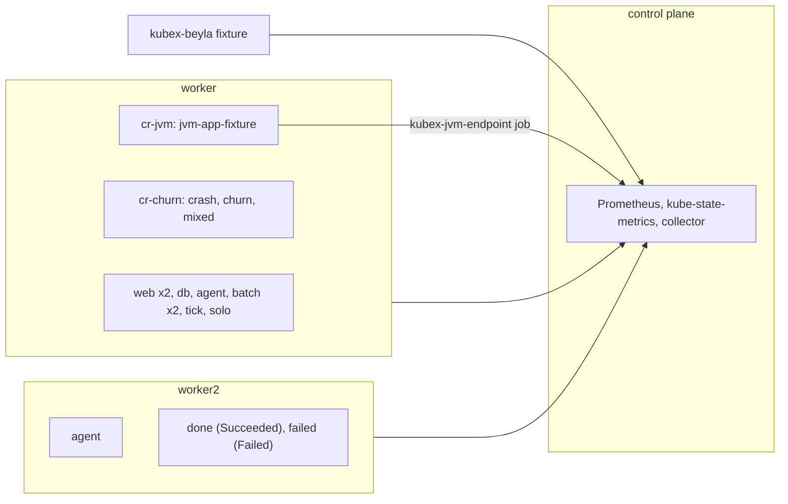

# container-resources

Proves the collector's container, resource quota, restart and JVM handling against Kubernetes and fixture truth.
Read this to find what a container-resources failure means or to extend the scenario.

Code: [`test_container_resources.py`](../../scenarios/container-resources/test_container_resources.py), [`workload.yaml`](../../scenarios/container-resources/workload.yaml)

## Purpose

- Every owner kind the collector resolves (Deployment, StatefulSet, DaemonSet, Job, CronJob, bare Pod)
  gets correct `container/` rows: identity, requests, limits, labels, QoS, restarts, power state and size.
- A native sidecar is reported. A standard init container is not.
- A ResourceQuota produces correct `rq/` files and namespace quota columns.
- A completed Job and a failed Pod keep their requests in the API. Node, node group and cluster totals
  must exclude them.
- Restarts and pod churn produce correct `events.csv`, `max_restarts.csv`, request series and power state.
- A JVM that exports JMX series gives heap attributes, one detailed `java` runtime and 12 workload files.
  Beyla surveys the same container, and the exporter's entry must replace it.

## Setup

| Item | Value |
| --- | --- |
| Cluster | 1 control plane (system pods) + 2 workers in node group `cr-workers` (`topology.kubex.ai/node-group`). `crashLoopBackOff.maxContainerRestartPeriod: 1s` on every kubelet. |
| Workloads | `cr-workload` (with quota `cr-quota`): `web` (2 replicas, init `setup`, sidecar `proxy`, `app`), `db`, `agent` (DaemonSet), `batch` (2 parallel pods), `tick` (CronJob), `solo` (exits 42 once, then runs), `done` (completed Job), `failed` (failed Pod). `cr-churn`: `crash` (exits 42 every ~102 s), `churn` (CronJob, 90 s pods every minute), `mixed` (Indexed Job, one pod finishes, one runs). `cr-jvm`: the fixture Deployment `jvm-app-fixture` (container `metrics`, no requests) on `worker`. |
| Fixtures | `kubex-beyla`: `survey_info` runtimes for `web/app` (go), `db/db` (java) and `cr-jvm/jvm-app-fixture/metrics` (java), standing in for Beyla. `jvm-app` (port 9404): JMX exporter series for one JVM. |
| Collector settings | `Collection(interval="minutes", interval_size=3, history=1, sample_rate=1)`, `node_group_list=label_topology_kubex_ai_node_group`. Node exporter disabled. `prometheus.appScrapeConfigs.jvm.serviceLabels` selects the `jvm-app` Service, so the chart's `kubex-jvm-endpoint` job scrapes it and adds `namespace`, `pod` and `container`. |
| Window | 240 s |
| Readiness gates | `running` (9), `succeeded`, `failed`, `terminal-requests` (4), `sidecars` (2), `cronjob-job`, `agent-available`, `solo-restarted`, `churn-running`, `mixed-running`, `mixed-finished`, `crash-restarted`, `quota-used-<key>` (one per `QUOTA_USED` key), `survey` (2), `jvm-families` (9), `jvm-gc-history` (2), `jvm-survey` (1). Lifecycle waits for `web` and `done`. |
| Snapshots | `resourcequotas`, `namespaces`, `deployments`, `statefulsets`, `daemonsets`, `jobs`, `cronjobs` |



`cr-churn` and `cr-jvm` have no quota and no CPU or memory requests, so they leave the `cr-workload` totals stable.

## What the collector collects

### container/ attributes

The collector reads `kube_pod_container_resource_requests` and `_limits`, `kube_pod_status_qos_class` and
the pod phase. CPU is whole mcores and memory is floored MiB. A finished pod has empty requests and limits.

```csv
EntityName,ContainerName,CpuRequest,CpuLimit,MemoryRequest,MemoryLimit,PowerState,QosClass
web,app,250,500,128,256,Running,Burstable
done,work,,,,,Terminated,Burstable
```

### rq/ quota files

The collector reads `kube_resourcequota`. Attributes hold `used` in mcores and MiB and `hard` in the
`Namespace*` columns. Series files repeat one `used` value per step: 2501 mcores (`cpu_requests.csv`),
864 MiB (`mem_requests.csv`) and 1543503872 bytes (`mem_limits.csv`).

```csv
file,CpuRequest,CpuLimit,MemoryRequest,MemoryLimit,CurrentSize,NamespaceCpuLimit
rq/attributes.csv,2501,4001,864,1472,9,8008
```

### Restarts and events

`max_restarts.csv` comes from `increase(kube_pod_container_status_restarts_total)`. `events.csv` adds the
exit code and time from `kube_pod_container_status_last_terminated_*`. `crash` exits 42 about every
100 s. It has one event per exit, and its `MaxRestarts` is 1 on the step after each exit (20:59:00 and
21:01:00 here) and 0 between. Every other container is 0.

```csv
EntityName,EventTime,ExitCode,IsPid1
crash,2026-10-21T20:58:51Z,42,true
```

### JVM attributes and workload files

The heap columns come from `jvm_memory_init_bytes` and `jvm_memory_max_bytes` with `area="heap"`, as
float MiB printed with `%f`. The fixture also serves `area="nonheap"` init 2048 MiB and max 4096 MiB, which
must not reach them. `Runtimes` comes from `jvm_runtime_info`: one `java` entry, version `21.0.5+11-LTS`,
runtime `OpenJDK Runtime Environment`, vendor `Eclipse Adoptium`, plus the label `runtime.kubex.ai=java`.
Beyla also surveys the container as java, and the exporter's entry replaces it by name. Containers
without an exporter, such as `db`, have empty heap columns.

```csv
fixture series,bytes,column,value
jvm_memory_init_bytes{area="heap"},268959744,JvmHeapInitMib,256.500000
jvm_memory_max_bytes{area="heap"},1074003968,JvmHeapMaxMib,1024.250000
```

The 12 files `container/avg_<stem>.csv` and `max_<stem>.csv` hold the pod's value in every grid row. Memory
stems are MiB (bytes / 2^20). GC overhead is the summed rate of `jvm_gc_collection_seconds_sum` times 100.

```csv
stem,fixture input,value
jvm_heap_used_mib,300 MiB,300
jvm_non_heap_used_mib,96.5 MiB,96.5
jvm_buffers_used_mib,8 + 0.5 MiB in two pools,8.5
jvm_post_gc_used_mib,0 + 120 + 4 MiB in three pools,124
jvm_thread_count,42 threads,42
jvm_gc_overhead_pct,(0.02 + 0.005) s of GC per second,2.5
```

## Truth sources

| Source | Used for |
| --- | --- |
| Pod specs in `oracle.primary` | Requests, limits, images, labels, QoS, restart counts, node placement |
| Owner, namespace and `cr-quota` objects in the snapshots | `CreateTime`, labels and annotations, `status.hard` / `status.used` for `rq/` files and `Namespace*` columns |
| Oracle (`requests`, `limits`, `pod_count`) | W2, group and cluster totals without terminal pods |
| Every snapshot (`oracle.snapshots`) | Restart times (`lastState.terminated.finishedAt`, new `startedAt`) and churn pod spans |
| `RUNTIMES` and `JVM_*` fixture constants | `Runtimes`, the JVM heap columns and the JVM workload files |
| `expected_timestamps` | `MetricTime` grid (3-minute interval, 1-minute step) |

## Tests

### Premise (the cluster is what the expectations assume)

| Test | Asserts | Truth | A failure means |
| --- | --- | --- | --- |
| `test_terminal_pods_stay_terminal_and_reserve_resources` | `done` Succeeded and `failed` Failed on W2 in every snapshot, holding 1 CPU and 512Mi of requests | snapshot | The exclusion tests could not fail. Fix the setup. |
| `test_workload_is_steady_through_the_window` | `cr-workload` pods, phases, nodes, restart counts and quota usage are identical in every snapshot | snapshot | The cluster moved. Value tests are not trustworthy. |
| `test_quota_status_reports_cpu_under_both_keys` | Kubernetes reports `cpu` == `requests.cpu` in hard and used | snapshot | The rq CPU expectation no longer holds. |
| `test_crash_cadence` | `crash` restarts one at a time, at least twice, exit 42, at most 115 s apart | snapshot | The capped back-off did not apply, so restart tests have nothing to match. |

### container/ and rq/

| Test | Asserts | Truth | A failure means |
| --- | --- | --- | --- |
| `test_container_identities` | One row per container in `attributes.csv` and `config.csv`, none for init `setup` | snapshot | A container is missing, duplicated or wrongly reported |
| `test_attribute_identity_columns` | `ContainerType` (`NativeSidecarInit` for `web/proxy`), `Virtual*`, `CreatedByKind/Name` | snapshot | Owner resolution or sidecar detection is wrong |
| `test_request_and_limit_attributes` | CPU in whole mcores, memory in floored MiB. Empty for terminal pods. | snapshot | Wrong unit, rounding or source |
| `test_power_state` | `Running`, or `Terminated` for `done` and `failed` | snapshot | Wrong state for terminated pods |
| `test_current_size_attribute` | Running pods per owner. Empty for bare pods, 0 for a finished Job. | snapshot | Wrong owner size |
| `test_container_restarts` | Sum of `restartCount` (`solo` is 1) | snapshot | Restart counter is wrong |
| `test_qos_class` | Pod `status.qosClass` | snapshot | Wrong QoS |
| `test_create_time` | Owner `creationTimestamp` | snapshot | Wrong creation time |
| `test_current_nodes` | Nodes of every pod, terminal pods included | snapshot | Wrong node list |
| `test_pod_labels` | Owner + pod labels in kube-state-metrics form | snapshot | Labels lost or merged wrongly |
| `test_container_labels_carry_the_image` | `image_spec` equals the spec image | snapshot | Wrong image label |
| `test_namespace_quota_columns` | `Namespace*` columns equal `cr-quota` `status.hard` | snapshot | Quota not attached to containers |
| `test_namespace_labels` | Namespace labels and annotations, last-applied annotation dropped | snapshot | Namespace metadata wrong |
| `test_runtimes_come_from_the_survey` | `Runtimes` JSON matches the Beyla fixture | fixture | Survey not joined to the container |
| `test_container_config` | `HwTotalMemory` = memory limit in MiB (empty if terminated), `OsName`, `HwManufacturer`, `AuditTime` | snapshot | Config row wrong |
| `test_request_and_limit_series_follow_the_grid` | `cpu_request`, `cpu_limit`, `memory_request`, `memory_limit`: exact identities (no terminal pods) and grid | snapshot, grid | Missing or extra series or steps |
| `test_request_and_limit_series_match_the_spec` | Raw mcores and MiB within 1e-6 | snapshot | Wrong value or unit |
| `test_current_size_series_follow_the_grid` | `current_size.csv` identities are the controllers, on the grid | grid | Missing or extra series |
| `test_current_size_series_match_running_pods` | Every sample equals the running pod count | snapshot | Wrong size |
| `test_jvm_attributes_come_from_the_exporter` | `JvmHeapInitMib` 256.500000 and `JvmHeapMaxMib` 1024.250000 from `area="heap"` only, one `java` runtime with the exporter's details, label `runtime.kubex.ai=java` | fixture | Wrong area, unit or truncation, or Beyla's entry duplicated instead of replaced |
| `test_other_containers_have_no_jvm_heap` | Every other container, `db` included, has empty heap columns | fixture | JVM data leaks to a container without an exporter |
| `test_jvm_workloads_match_the_fixture` | Each of the 12 `container/{avg,max}_jvm_*.csv` holds only the fixture container, on the grid, with the fixture value | fixture, grid | Wrong aggregation, MiB conversion or GC rate |
| `test_restart_events` | `events.csv` holds only `crash` rows, with exit 42 and an `EventTime` that matches an observed termination. No duplicates. Every termination safely inside the window has exactly one event. | snapshot | Restart events lost, invented or duplicated |
| `test_max_restarts_match_restarts` | `max_restarts.csv` for `crash` is on the grid and 0 or 1. Each 1 matches an observed restart, and no observed restart is missing. All other containers are 0. | snapshot, grid | Restart series wrong |
| `test_churn_request_series_cover_the_grid` | A `churn` pod runs at every step, and its ephemeral-storage request series covers the grid with the spec value | snapshot, grid | Series dropped when pods turn over |
| `test_power_state_of_owners_with_finished_pods` | `churn` and `mixed` are `Running` while any of their pods runs | snapshot | A finished pod overrides the running one |
| `test_quota_is_described_once` | One `cr-quota` row in `config.csv` and `attributes.csv` | snapshot | Quota missing or duplicated |
| `test_quota_description` | `Virtual*`, `CreateTime`, `ResourceMetadata` = `status.hard` | snapshot | Description wrong |
| `test_quota_attributes` | Used columns from `status.used`, `Namespace*` from `status.hard` | snapshot | Wrong value or unit |
| `test_quota_series_follow_the_grid` | Each `rq/*` series is on the grid | grid | Missing or extra steps |
| `test_quota_series_match_status_used` | Each sample equals `status.used` in the file's unit | snapshot | Wrong value or unit |

### node/, node_group/, cluster/ without terminal pods

| Test | Asserts | Truth | A failure means |
| --- | --- | --- | --- |
| `test_terminal_pods_are_excluded_from_series` | W2 request, limit and pod-count series, and group and cluster request series, equal the oracle on every grid step | oracle, grid | `done` or `failed` counted in totals |
| `test_terminal_pods_are_excluded_from_attributes` | W2, group and cluster attribute totals in whole mcores and MiB | oracle | Same, in attributes |

## Not covered

- Only the JMX exporter is served. The OpenTelemetry Java agent reaches the same collector code through
  other query strings, and the merge used when both exporters are present is not exercised.
- One pod with constant gauges serves the JVM series, so `avg_` and `max_` files hold one value and swapped
  aggregations go unnoticed. Telling them apart needs two pods with different values under one owner,
  which the fixture machinery cannot serve. The same gap hides which pod supplies the heap attribute of a
  multi-pod owner whose pods differ.
- Each JVM area has one series, so a lost `area` filter shows in `jvm_non_heap_used_mib` but not in
  `jvm_heap_used_mib`, whose value is the larger.
- kube-state-metrics v1 request series are not served. The chart deploys v2.
- `cr-workload` has one quota, so the choice between two quotas with different keys is not checked.
- No Deployment is updated in the window, so `CurrentSize` during a rolling update is not checked.

## Run and replay

```sh
.venv/bin/python -m pytest scenarios/container-resources -v --tb=short
.venv/bin/python -m pytest scenarios/container-resources --replay <artifact-dir> -q --tb=short
```

## Extend

- **New owner or container.** Add it to `workload.yaml` with the label `stack-e2e.kubex.ai/entity`, to
  `CONTAINERS` and `ENTITY_TYPES`, and to `CONTROLLERS` if it is sized. Update the `running` gate count.
  If it requests CPU or memory in `cr-workload`, update `QUOTA_USED`.
- **New churn.** Put it in `cr-churn` without CPU or memory requests, so totals and quota stay steady.
- **New JVM series.** Add it to `_jvm_series()`. For a workload file, add its stem to `JVM_STEMS` and a
  hand-computed value to `JVM_WORKLOADS`, and update the `jvm-families` gate count.
- Coverage entries reference this module through the `_CR` prefix in
  [`harness/coverage.py`](../../harness/coverage.py).
- Follow [extending.md](../extending.md) for the general steps.
