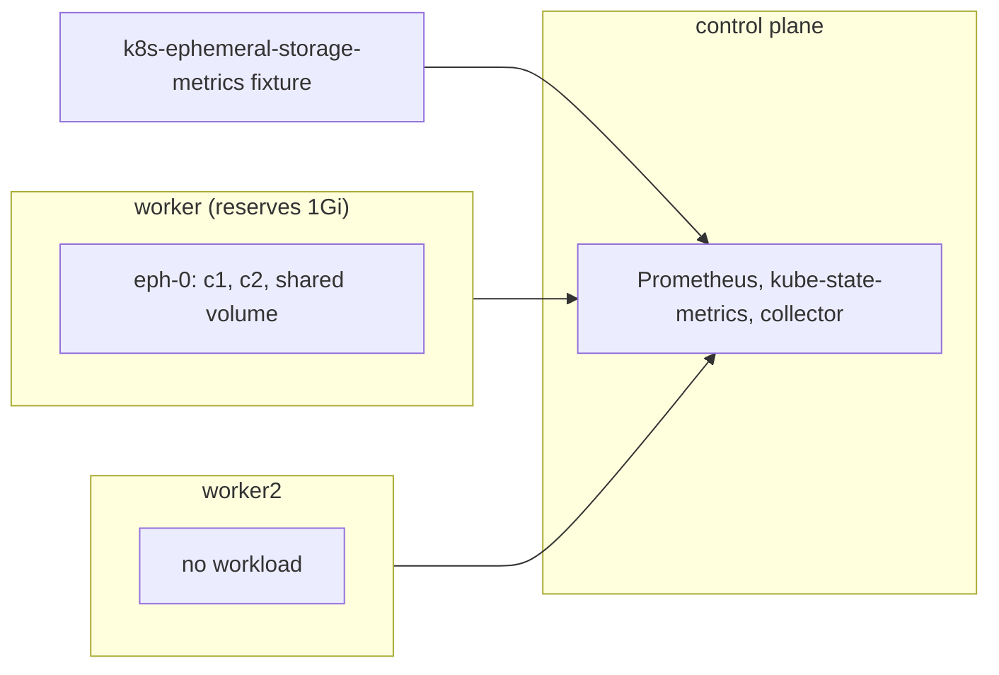

# ephemeral-storage

Proves the collector's node ephemeral-storage usage and reservation, and container ephemeral-storage requests, limits and usage.
Read this to find what an `ephemeral_storage_*` file failure means or to extend the scenario.

Code: [`test_ephemeral_storage.py`](../../scenarios/ephemeral-storage/test_ephemeral_storage.py), [`workload.yaml`](../../scenarios/ephemeral-storage/workload.yaml)

## Purpose

- Node usage is exporter capacity minus availability, in bytes. Utilization divides that by Kubernetes
  allocatable, not by the exporter's capacity. One worker reserves 1Gi, so the two denominators differ.
- Node ephemeral request, limit and reservation percent follow the pods' specs and node allocatable.
  Only the worker that runs the pod has a request and limit row.
- Container usage is rootfs plus logs plus volumes. A volume that both containers mount is counted once
  per pod, so the two containers differ by exactly that volume's size.
- Container request and limit series are in bytes, and the attributes hold whole MiB.
- The collector detects the exporter. Without it the usage files are missing, which `test_expected_files` reports.

## Setup

| Item | Value |
| --- | --- |
| Cluster | 1 control plane (`stack-e2e-system=system`, runs the stack) + 2 workers in node group `eph-workers` (`topology.kubex.ai/node-group`). Worker 1 sets kubelet `system-reserved: ephemeral-storage=1Gi`. |
| Workloads | `ephemeral-storage-workload`: StatefulSet `eph` (1 replica, pod `eph-0`) pinned to worker 1. Containers `c1` (100Mi request, 200Mi limit) and `c2` (300Mi, 500Mi), each with its own `emptyDir`, plus one shared `emptyDir`. |
| Fixtures | `k8s-ephemeral-storage-metrics`: stands in for the chart's exporter of the same name (the chart's copy is disabled, so Prometheus keeps the target). Serves node capacity and availability for all three nodes, and rootfs, log and volume usage for `eph-0`. |
| Collector settings | `Collection(interval="minutes", interval_size=1, history=1, sample_rate=1)`, `node_group_list=label_topology_kubex_ai_node_group`. Node exporter, Beyla, GPU process exporter and node labeler are disabled. |
| Window | 180 s |
| Readiness gates | `exporter-nodes` (3), `exporter-volumes` (4), `eph-running`, `eph-owner`, `eph-requests` (2), `eph-limits` (2), `allocatable-storage` (3) |
| Snapshots | nodes and pods only |



The module's comment on `NODE_STORAGE` and `VOLUMES` lists the fixture numbers. `OWN` is each container's
usage without the shared volume.

## What the collector collects

### node/ usage and reservation

Usage comes from the exporter's `ephemeral_storage_node_capacity` and `ephemeral_storage_node_available`
(bytes). Utilization divides usage by the node's Kubernetes allocatable, not the exporter's capacity.
Request, limit and reservation percent come from kube-state-metrics pod requests and limits for
`ephemeral_storage` (bytes) and node allocatable. Only a node that runs a pod with a request has a
row in those three files.

Input: worker has capacity 200 GiB and available 150 GiB. `eph-0` requests 100Mi + 300Mi. Rows for worker:

```csv
NodeName,EphemeralStorageUsageBytes,EphemeralStorageUsageUtilization,EphemeralStorageRequest,EphemeralStorageReservationPercent
worker,53687091200,34.90,419430400,0.2727
```

Usage is 200 GiB - 150 GiB = 50 GiB. Utilization and reservation use the worker's real allocatable
(about 154 GB on the CI runner, read from the node), so the example numbers vary with the host disk.
`worker2` has a usage row and no request row.

### container/ usage and attributes

Usage is rootfs plus logs plus volume usage from `ephemeral_storage_container_rootfs_used_bytes`,
`_logs_used_bytes` and `_volume_usage`. A volume mounted by both containers is counted once per pod.
The series files hold bytes. `container/attributes.csv` holds the spec request and limit in whole MiB.

Input: `c1` rootfs 10 MiB, logs 1 MiB, own volume 30 MiB. `c2` 20, 2 and 40 MiB. Shared volume 50 MiB.

```csv
ContainerName,EphemeralStorageUsageBytesAvg,EphemeralStorageRequest (series),EphemeralStorageRequest (attributes)
c1,95420416,104857600,100
c2,65011712,314572800,300
```

`c1` is 41 MiB + the shared 50 MiB, `c2` is 62 MiB. Which container takes the shared volume does not
matter, but exactly one does.

## Truth sources

| Source | Used for |
| --- | --- |
| Kubernetes snapshots (`oracle.primary`) | Node capacity and allocatable, container requests and limits in `eph-0` |
| Oracle (`oracle.requests` / `limits` / `reservation_percent` with `ephemeral-storage`) | Node request, limit and reservation percent |
| Fixture series (`NODE_STORAGE`, `ROOTFS`, `LOGS`, `VOLUMES`, `OWN`, `SHARED`) | Node and container usage |

## Tests

### Premise (the cluster is what the expectations assume)

| Test | Asserts | Truth | A failure means |
| --- | --- | --- | --- |
| `test_reserved_worker_has_less_allocatable_storage` | Worker 1 loses exactly 1Gi more between capacity and allocatable than worker 2 | snapshot | The reservation did not apply. Utilization tests cannot tell capacity from allocatable. |

### node/ and container/ grids

| Test | Asserts | Truth | A failure means |
| --- | --- | --- | --- |
| `test_ephemeral_series_follow_the_collector_grid` | Seven files, each with the expected identities on every grid step: node usage files cover all nodes, node request, limit and reservation files cover only worker 1, container files cover `c1` and `c2` | oracle, grid | A node or container is missing or extra, or steps are missing |

### node/ values

| Test | Asserts | Truth | A failure means |
| --- | --- | --- | --- |
| `test_node_request_limit_and_reservation` | Request and limit in bytes, reservation as a percent of allocatable | oracle | Wrong total, unit or denominator |
| `test_node_usage_matches_the_fixture` | Usage is capacity minus available. Utilization is that over Kubernetes allocatable, so it can exceed 100. | fixture, snapshot | Utilization uses the exporter's capacity, or usage is wrong |

### container/ values

| Test | Asserts | Truth | A failure means |
| --- | --- | --- | --- |
| `test_container_usage_counts_each_volume_once` | In the average and maximum files, each container's usage differs from `OWN` by a steady offset, and the offsets are 0 and `SHARED` | fixture | The shared volume is counted twice, for neither container, or the usage drifts |
| `test_container_request_and_limit_series_in_bytes` | Request and limit series equal the pod spec in bytes | snapshot | Wrong value or unit |
| `test_container_attributes_in_mib` | `EphemeralStorageRequest` and `EphemeralStorageLimit` in `container/attributes.csv` equal the spec in whole MiB | snapshot | Attributes use bytes or round wrongly |

## Extend

- **New container or volume.** Add it to `workload.yaml`, then to `CONTAINERS`, `ROOTFS`, `LOGS`,
  `VOLUMES` and `OWN`. Update `SHARED` if the shared volume changes, and the `exporter-volumes` and
  `eph-requests` / `eph-limits` readiness counts.
- **New node.** Add it to `NODE_STORAGE`, which is keyed by the Kind node name.
- **New ephemeral file.** Add its path to `EPHEMERAL_FILES` and write a value test.
- Follow [extending.md](../extending.md) for the general steps.
