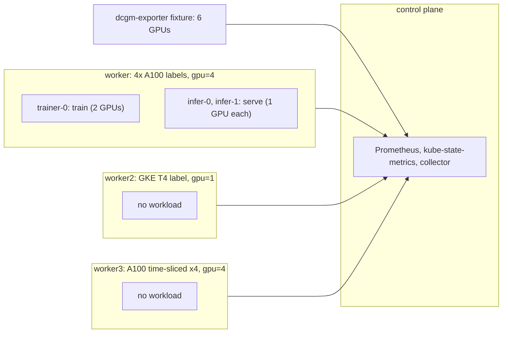

# gpu-device-plugin

Proves the collector's node, node group, cluster and container GPU columns for nodes that advertise GPUs as extended resources, label them like GPU feature discovery and serve DCGM metrics.
Read this to find what a `gpu_*` file or GPU column failure means or to extend the GPU setup.

Code: [`test_gpu_device_plugin.py`](../../scenarios/gpu-device-plugin/test_gpu_device_plugin.py), [`workload.yaml`](../../scenarios/gpu-device-plugin/workload.yaml)

## Purpose

- GPU capacity, allocatable, requests and limits come from the `nvidia.com/gpu` extended resource
  through kube-state-metrics. No device plugin runs. The harness patches node capacity and the kubelet
  mirrors it into allocatable, which is all the collector reads.
- GPU labels set the node attributes: product, count, memory, replicas, sharing strategy, MIG, MPS and
  vGPU flags. Three nodes cover the GFD label set, a GKE accelerator label only, and a time-sliced GPU.
  DCGM's model name overrides the label product.
- DCGM series give node, group and container utilization, memory and power. The collector's per-container
  rule differs from the per-node rule, and a time-sliced node counts physical GPUs, not slices.
- A container bound to several GPUs, and an owner with replicas that differ, must aggregate per pod first
  and then across replicas. Average, maximum and sum come out as different numbers.
- A GPU bound to no container (the GKE node and the time-sliced node) is attributed to nobody.

## Setup

| Item | Value |
| --- | --- |
| Cluster | 1 control plane (`stack-e2e-system=system`, runs the stack) + 3 workers, all in node group `gdp-workers` (`topology.kubex.ai/node-group`). Worker 1: GFD labels of a 4-GPU A100 node (`W1_GPU_LABELS`), `nvidia.com/gpu=4`. Worker 2: GKE label `cloud.google.com/gke-accelerator`, `nvidia.com/gpu=1`. Worker 3: one A100 time-sliced four ways (`W3_GPU_LABELS`), `nvidia.com/gpu=4`. |
| Workloads | `gdp-workload`, both pinned to worker 1: StatefulSet `trainer` (1 replica, container `train`, 2 GPUs) and `infer` (2 replicas, container `serve`, 1 GPU each). |
| Fixtures | `dcgm-exporter`: six GPUs from `GPUS` (four on worker 1, one each on workers 2 and 3). Worker 1's GPUs bind to `trainer-0/train` (0, 1), `infer-0/serve` (2) and `infer-1/serve` (3) with different utilization, memory and power. The service name puts it under the chart's DCGM scrape rule. |
| Collector settings | `Collection(interval="minutes", interval_size=1, history=1, sample_rate=1)`, `node_group_list=label_topology_kubex_ai_node_group`. Node exporter, GPU process exporter, Beyla, node labeler and the ephemeral-storage exporter are disabled. |
| Window | 180 s (gauges only, so `avg_over_time` needs samples from two minutes back) |
| Readiness gates | `gpu-allocatable` (3), `pods-running` (3), `owners` (3), `dcgm-gpus` (6) |
| Snapshots | nodes and pods only |



Each node's `nvidia.com/gpu` count is the `extended_resources` value in `CLUSTER_SPEC`. The module's
`GPUS` list is the single source for fixture values, and its `assert` blocks check the formulas against
hand-computed numbers.

## What the collector collects

### node/attributes.csv GPU columns

The collector reads `kube_node_status_capacity` and `_allocatable` for `nvidia_com_gpu`, and the GPU
labels from `kube_node_labels` (`label_nvidia_com_gpu_*`, or the GKE accelerator label). Labels set count,
memory, replicas, sharing strategy and the MIG, MPS and vGPU flags. A missing label falls back to
allocatable (count, replicas) or to the DCGM memory sum. DCGM's `modelName` wins over the label product.
`GpuLabels` holds the GPU labels, which are removed from `NodeLabels`.

Input: worker has the A100 GFD labels and 4 GPUs, worker2 has only the GKE T4 label and 1 GPU,
worker3 is one A100 time-sliced four ways. Rows, with `...` for the other columns:

```csv
NodeName,AllocatableGpu,GpuTotal,GpuMemoryTotal,GpuReplicas,GpuModel,GpuSharingStrategy,GpuMpsCapable
worker,4,4,40960,1,NVIDIA A100-SXM4-40GB,none,true
worker2,1,1,15360,1,Tesla T4,,false
worker3,4,1,40960,4,NVIDIA A100-SXM4-40GB,time-slicing,false
```

Worker3 advertises 4 allocatable slices but holds 1 GPU, so `GpuTotal` is the label (1).
`GpuMemoryTotal` is MiB.

### node/, node_group/, cluster/ GPU requests and DCGM series

Requests and limits come from kube-state-metrics pod requests for `nvidia_com_gpu`. The reservation
percent is requests over allocatable. `*_avg` utilization and memory series average DCGM
`DCGM_FI_DEV_GPU_UTIL`, `_FB_USED` and `_FB_FREE` over a node's GPUs. Memory used and power
(`DCGM_FI_DEV_POWER_USAGE`) are sums. A node group averages its members.

Input: worker's four GPUs run at 30, 50, 20 and 60 % and use 10000, 14000, 6000 and 9000 MiB.

```csv
file,entity,value
node/gpu_request.csv,worker,4
node/gpu_utilization_avg.csv,worker,40
node/gpu_utilization_gpus_avg.csv,worker,1.6
node/gpu_mem_used_avg.csv,worker,39000
node_group/gpu_requests.csv,gdp-workers,4
cluster/gpu_reservation_percent.csv,gpu-device-plugin,44.44
```

GPUs-busy is utilization times physical GPUs (0.4 x 4). Cluster reservation is 4 requested over 9
allocatable (4 + 1 + 4 slices).

### container/ GPU columns

A container's GPUs come from the DCGM series with its `namespace`, `pod` and `container` labels. Per pod,
utilization is the mean over its GPUs, memory used and power are sums. The owner's `avg` or `max` file
then runs over its replicas.

```csv
EntityName,ContainerName,GpuRequest,GpuUtilizationAvg,GpuUtilizationMax,GpuMemUsedAvg,GpuMemUsedMax
trainer,train,2,40,40,24000,24000
infer,serve,1,40,60,7500,9000
```

`infer-0` runs at 20 % and 6000 MiB, `infer-1` at 60 % and 9000 MiB, so mean and maximum differ.
`trainer-0` holds GPUs 0 and 1 (30 and 50 %, 10000 and 14000 MiB). The W2 and W3 GPUs belong to no
container.

## Truth sources

| Source | Used for |
| --- | --- |
| Kubernetes snapshots (`run.snapshots`, `oracle.primary`) | Node capacity and allocatable GPU, container GPU requests and limits, GPU labels |
| Oracle (`oracle.requests` / `limits` / `reservation_percent` with `nvidia.com/gpu`) | Node, group and cluster GPU requests, limits and reservation percent |
| Fixture series (`GPUS`, `_container_truth`, `_owner_truth`, `_node_truth`, `_group_truth`) | Every DCGM value at node, group and container level |

## Tests

### Premise (the cluster is what the expectations assume)

| Test | Asserts | Truth | A failure means |
| --- | --- | --- | --- |
| `test_extended_resources_persist_through_the_window` | Capacity and allocatable `nvidia.com/gpu` match `extended_resources` on workers in every snapshot, and the control plane has none | snapshot | The patched capacity was lost. GPU tests would compare against a changed cluster. |

### node/

| Test | Asserts | Truth | A failure means |
| --- | --- | --- | --- |
| `test_node_gpu_attributes` | Per node: `GpuLimit`, `GpuRequest`, `CapacityGpu`, `AllocatableGpu`, `GpuTotal`, `GpuMemoryTotal`, `GpuReplicas`, `GpuVendor`, `GpuModel`, `GpuSharingStrategy` and the MPS, vGPU and MIG columns. Labels win over DCGM for count and memory. Missing labels fall back to allocatable or the DCGM sum. DCGM's model name wins over the label product. | snapshot, oracle, fixture | A label is ignored, a fallback is wrong, or a node without GPUs gets GPU values |
| `test_node_gpu_labels` | `GpuLabels` equals the node's GPU labels, and none of them stay in `NodeLabels` | snapshot | GPU labels are not split out of the node labels |
| `test_node_gpu_request_and_limit_series` | Worker 1's `gpu_request` and `gpu_limit` series equal the oracle totals, and no other node has a row | oracle | Wrong GPU total or a node without GPU requests reported |
| `test_node_dcgm_series` | Five `*_avg.csv` files for the three workers (none for the control plane). Utilization and memory utilization are means over the node's GPUs, memory used and power sums, GPUs-busy counts physical GPUs. | fixture | DCGM series joined to the wrong node, or time-sliced slices counted as GPUs |

### node_group/ and cluster/

| Test | Asserts | Truth | A failure means |
| --- | --- | --- | --- |
| `test_group_gpu_requests_and_reservation` | `gpu_requests` and `gpu_reservation_percent` for `gdp-workers` equal the oracle | oracle | Wrong group total or reservation |
| `test_group_dcgm_series` | Utilization, GPUs-busy and memory utilization are the mean of the node values, memory used and power their sum | fixture | Group aggregation of node DCGM values is wrong |
| `test_cluster_gpu_requests_and_reservation` | `cluster/gpu_requests.csv` and `gpu_reservation_percent.csv` equal the oracle over all Linux nodes | oracle | Wrong cluster total or reservation |

### container/

| Test | Asserts | Truth | A failure means |
| --- | --- | --- | --- |
| `test_container_gpu_attributes` | `GpuLimit`, `GpuRequest`, their float forms, `GpuModel` and `GpuSharingStrategy` for `trainer/train` and `infer/serve`. Every other container has empty GPU columns. | snapshot, fixture | A container gets another container's GPU values, or a system container gets any |
| `test_container_gpu_memory_total` | `GpuMemoryTotal` in `container/config.csv` is the sum of the container's GPUs, averaged over replicas with integer division. Empty for others. | fixture | Memory total is not summed per container, or the average is wrong |
| `test_container_gpu_request_and_limit_series` | `container/gpu_request.csv` and `gpu_limit.csv` hold exactly the two GPU containers, with the spec values | snapshot | Wrong identity or value |
| `test_container_dcgm_workloads_match_the_fixture` | Ten `*_avg_workload` and `*_max_workload` files. Per pod first, then the owner's average or maximum over replicas. | fixture | DCGM values are bound to the wrong container, or replicas are summed or averaged in the wrong order |

## Not covered

- No NVIDIA hardware or device plugin runs. The harness patches node capacity and a fixture serves DCGM,
  so real driver and device-plugin behaviour is not checked.
- The fixture serves no reserved framebuffer memory (`DCGM_FI_DEV_FB_RESERVED`, reported by newer DCGM),
  so GPU memory totals that would include it are not checked.
- The one node without the `nvidia.com/gpu.memory` label (`worker2`) holds one GPU, so a memory total
  per GPU and a memory total per node look the same. A multi-GPU node without the label is not set up.

## Extend

- **New GPU or node.** Add a row to `GPUS` and its labels and `extended_resources` to `CLUSTER_SPEC`.
  Update `GPU_LABELS`, the node unpacking (`CP, W1, W2, W3`), and the `gpu-allocatable` and `dcgm-gpus`
  readiness counts.
- **New GPU container.** Add the workload, then `CONTAINERS` (entity, container to pods), `_TRAINER` or
  `_INFER`-style truth, and the `pods-running` and `owners` counts.
- Follow [extending.md](../extending.md) for the general steps.
