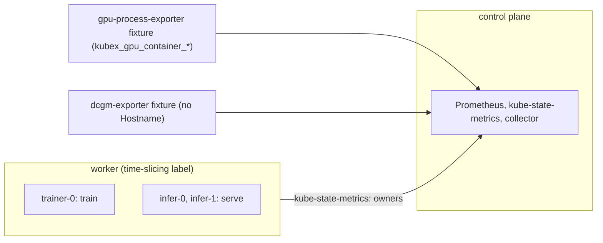

# gpu-telemetry-fixtures

Proves the collector takes container GPU data from the Kubex GPU exporter, including series that a namespace-enforcing scrape relabels, and keeps node DCGM series that have no hostname.
Read this to find what a container GPU column or a DCGM node file failure means on this path.

Code: [`test_gpu_telemetry_fixtures.py`](../../scenarios/gpu-telemetry-fixtures/test_gpu_telemetry_fixtures.py), [`workload.yaml`](../../scenarios/gpu-telemetry-fixtures/workload.yaml)

## Purpose

- Container GPU requests, limits, model, memory total, utilization and memory used come from the
  `kubex_gpu_container_*` families. No pod requests `nvidia.com/gpu` and no node advertises one, so
  Kubernetes cannot be the source.
- Series relabelled by a namespace-enforcing scrape (the workload identity in `exported_namespace`,
  `exported_pod` and `exported_container`, the exporter's own identity in `namespace`, `pod` and
  `container`) are attributed to the workload.
- A fractional request (half a GPU under the KAI scheduler) shows in the float columns. The integer
  column holds the truncated value, and the sharing strategy is the scheduler's.
- When a DCGM fixture serves conflicting values for the same GPU, the container files still use the
  Kubex exporter, and no container power file exists.
- DCGM series without a `Hostname` label keep the node from the scrape's `node` label, in the node and
  node group files.

## Setup

| Item | Value |
| --- | --- |
| Cluster | 1 control plane (`stack-e2e-system=system`, runs the stack) + 1 worker in node group `gtf-workers` (`topology.kubex.ai/node-group`) with labels `nvidia.com/gpu.present` and `nvidia.com/gpu.sharing-strategy=time-slicing`. No extended resource. |
| Workloads | `gtf-workload`, both pinned to the worker: StatefulSet `trainer` (1 replica, container `train`) and `infer` (2 replicas, container `serve`). Neither requests a GPU. |
| Fixtures | `gpu-process-exporter`: `kubex_gpu_container_*` series for `SHARES`. `trainer-0` holds two whole GPUs with different values and is a plain scrape. `infer-0` and `infer-1` hold half a GPU each (KAI scheduler) with different values and are labelled with `exported_*`. `dcgm-exporter`: one GPU (`DCGM`) with values that conflict with infer-0's, with no `Hostname` label. |
| Collector settings | `Collection(interval="minutes", interval_size=1, history=1, sample_rate=1)`, `node_group_list=label_topology_kubex_ai_node_group`. Node exporter, the chart's GPU process exporter, Beyla, node labeler and the ephemeral-storage exporter are disabled. |
| Window | 240 s (`rate(...[1m20s])` in a subquery needs samples from three minutes back) |
| Readiness gates | `kubex-exported` (2), `kubex-gpus` (4), `dcgm` (1), `pods-running` (3), `owners` (3), `sharing-label` (1) |
| Snapshots | nodes and pods only |



The `kubex-exported` gate queries by `exported_namespace`, so the run only starts once the relabelled
series are in Prometheus with the exporter's own identity intact.

## What the collector collects

### container/ GPU columns from the Kubex exporter

The collector reads `kubex_gpu_container_requests` and `_limits` (GPUs, fractions allowed),
`kubex_gpu_container_sm_utilization_percent_seconds_total` (rate gives utilization %),
`kubex_gpu_container_memory_bytes` and `_memory_total_bytes` per GPU. The workload identity is
`namespace`, `pod`, `container`, or `exported_*` when the scrape relabelled them. Per pod, utilization is
the mean over its GPUs and memory used the sum. The owner's `avg` or `max` file runs over replicas.

Input: `trainer-0` holds two GPUs (40 and 60 %, 8192 and 12288 MiB), requests 2. `infer-0` and
`infer-1` hold 0.5 GPU each (25 and 75 %, 6144 and 10240 MiB), allocation `KaiScheduler`.

```csv
EntityName,GpuRequest,GpuRequestFloat,GpuSharingStrategy,GpuUtilizationAvg,GpuUtilizationMax,GpuMemUsedAvg,GpuMemUsedMax
trainer,2,2.000000,time-slicing,50,50,20480,20480
infer,0,0.500000,kai-scheduler,50,75,8192,10240
```

The integer column is the truncated request (0 for 0.5). The strategy is `kai-scheduler` when the
exporter says so, else the node's label. `GpuUtilizationGpusAvg` is utilization times the request:
1.0 for trainer, 0.25 for infer. Memory is MiB. `GpuMemoryTotal` in `container/config.csv` is the GPU
memory of the container's GPUs, in MiB: 81920 for trainer (2 x 40960), 40960 for infer.
Containers without Kubex series have empty GPU columns.

### node/ and node_group/ DCGM series without Hostname

The collector reads `DCGM_FI_DEV_GPU_UTIL`, `_FB_USED`, `_FB_FREE` and `_POWER_USAGE`. DCGM normally
names the node in `Hostname`. Here that label is absent, so the node comes from the scrape's `node` label.

Input: one GPU on worker at 90 %, 30000 MiB used of 40326, 250 W.

```csv
file,NodeName / NodeGroupName,value
node/gpu_utilization_avg.csv,worker,90
node/gpu_mem_utilization_avg.csv,worker,74.4
node/gpu_mem_used_avg.csv,worker,30000
node/gpu_power_usage_avg.csv,worker,250
node_group/gpu_mem_used_avg.csv,gtf-workers,30000
```

The group has one member, so each value equals the node's.

## Truth sources

| Source | Used for |
| --- | --- |
| Kubernetes snapshots (`run.snapshots`, `oracle.primary`) | The worker's sharing strategy label |
| Oracle | Not used |
| Fixture series (`SHARES`, `DCGM`, `_truth`, `_owner_truth`, `DCGM_NODE`) | Container requests, limits, utilization, memory, model, and the node and group DCGM values |
| Collector grid (`expected_timestamps`) | `MetricTime` steps of every series |

## Tests

### container/

| Test | Asserts | Truth | A failure means |
| --- | --- | --- | --- |
| `test_container_gpu_attributes` | `GpuLimit`, `GpuRequest`, their float forms, `GpuModel` and `GpuSharingStrategy` for `trainer/train` and `infer/serve` (`kai-scheduler` for infer, the node label for trainer). Every other container has empty GPU columns. | fixture, snapshot | Fractions truncated in the float columns, the wrong strategy, or GPU values on a container that has none |
| `test_container_gpu_memory_total` | `GpuMemoryTotal` in `container/config.csv` is the sum over the container's GPUs, averaged over replicas with integer division. Empty for others. | fixture | Memory total taken from DCGM or the wrong aggregation |
| `test_container_gpu_request_and_limit_series` | `gpu_request.csv` and `gpu_limit.csv` hold exactly the two GPU containers on the grid, with the exporter's values | fixture, grid | Requests read from Kubernetes instead of the exporter, or `exported_*` series not attributed |
| `test_kubex_workloads_match_the_fixture` | Eight `gpu_utilization`, `gpu_utilization_gpus`, `gpu_mem_utilization` and `gpu_mem_used` files, `avg` and `max`. Per pod first, then the owner's average or maximum over replicas. | fixture, grid | Container values come from DCGM, or per-GPU and per-replica aggregation is wrong |

The utilization counter files use the module's `RATE` tolerance for scrape jitter. Gauge files use
`EXACT`. No `gpu_power_usage` workload file is in `GPU_FILES`, because the Kubex path has no power
series for containers.

### node/ and node_group/ (DCGM without Hostname)

| Test | Asserts | Truth | A failure means |
| --- | --- | --- | --- |
| `test_dcgm_node_series_keep_the_scrape_node` | `gpu_utilization`, `gpu_mem_utilization`, `gpu_mem_used` and `gpu_power_usage` `*_avg.csv` for the worker equal the one GPU's values | fixture, grid | Series without `Hostname` are dropped or assigned to no node |
| `test_dcgm_group_series_keep_the_scrape_node` | The same four group files for `gtf-workers` equal the worker's values | fixture, grid | The node's DCGM data does not reach its group |

## Not covered

- No NVIDIA hardware runs. The Kubex GPU exporter and DCGM are fixtures, so real exporter output is
  not checked.
- Fixture values are constant, so a GPU memory peak between two minute marks never shows. Whether the
  `max` memory files sample at the scrape interval is not checked.

## Run and replay

```sh
.venv/bin/python -m pytest scenarios/gpu-telemetry-fixtures -v --tb=short
.venv/bin/python -m pytest scenarios/gpu-telemetry-fixtures --replay <artifact-dir> -q --tb=short
```

`files` is `BASE_FILES` (the same set as node-pressure) plus the 18 `GPU_FILES`. The module asserts
both counts.

## Extend

- **New share or replica.** Add a `Share` to `SHARES` and the workload to `workload.yaml`. `INSTANCES`,
  `CONTAINERS` and `IDENTITIES` follow from `SHARES`. Update the `kubex-exported`, `kubex-gpus`,
  `pods-running` and `owners` counts, and the hand-computed `assert` blocks.
- **New DCGM value.** Change `DCGM` and `DCGM_NODE`. Keep it different from the Kubex values so the test
  can tell the sources apart.
- Coverage inventory entries reference this module through the `_GTF` prefix in
  [`harness/coverage.py`](../../harness/coverage.py).
- Follow [extending.md](../extending.md) for the general steps.
