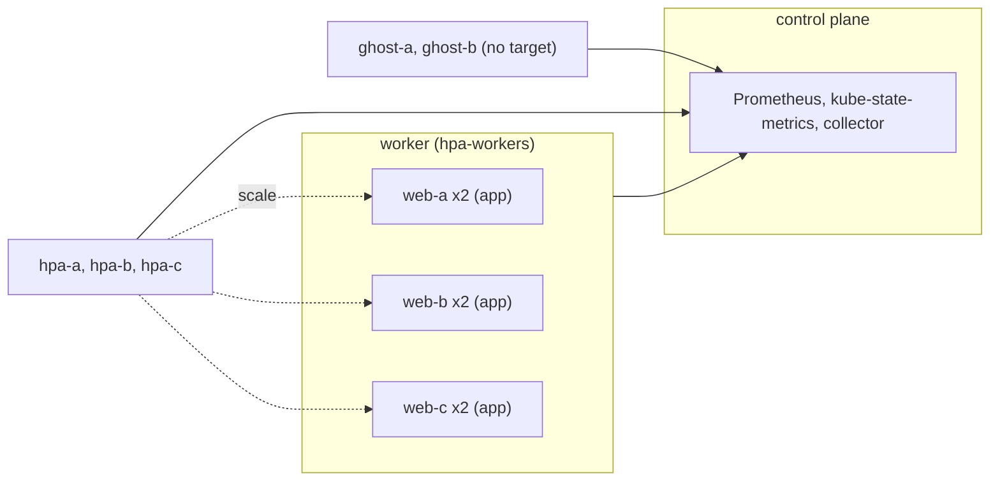

# hpa-orphans

Proves the collector attaches HorizontalPodAutoscalers to their target's container rows, reports HPAs whose target does not exist on their own, and writes no files that need the resource metrics API.
Read this to find what a `container/hpa_*`, `hpa/hpa_extra_*` or `Hpa*` column failure means.

Code: [`test_hpa_orphans.py`](../../scenarios/hpa-orphans/test_hpa_orphans.py), [`workload.yaml`](../../scenarios/hpa-orphans/workload.yaml)

## Purpose

- An HPA whose scale target runs containers gets `container/hpa_*.csv` series and `Hpa*` attribute
  columns on those container rows. Other containers have no HPA columns.
- An HPA whose target never exists ("orphan") gets `hpa/hpa_extra_config.csv`, `hpa_extra_attributes.csv`
  and `hpa_extra_*.csv` series, with empty entity columns and its target metrics intact.
- The HPAs use all four metric target types (CPU and memory, utilization and average value), so each
  target file holds exactly the HPAs that declare that target. One HPA has a single metric, so the
  collector keeps that metric's type and value.
- With `history=2` the collector runs one range query per interval. Every identity has the samples both
  intervals imply, including the shared boundary.
- No metrics-server is installed, so current CPU and memory and the `ScalingLimited` condition have no
  exact truth. Their files must be absent (checked by `test_expected_files`).

## Setup

| Item | Value |
| --- | --- |
| Cluster | 1 control plane (`stack-e2e-system=system`, runs the stack) + 1 worker in node group `hpa-workers` (`topology.kubex.ai/node-group`). No metrics-server. |
| Workloads | `hpa-orphans-workload`: Deployments `web-a`, `web-b` and `web-c` (2 replicas, container `app`). HPAs `hpa-a` (targets `web-a`, 2 to 4), `hpa-b` (targets `web-b`, 2 to 5) and `hpa-c` (targets `web-c`, 2 to 3, CPU utilization 40 % only). Orphans `ghost-a` (targets Deployment `ghost`, 1 to 3) and `ghost-b` (targets `phantom`, 3 to 6). `HPAS` in the module mirrors every spec value. |
| Fixtures | none |
| Collector settings | `Collection(interval="minutes", interval_size=1, history=2, sample_rate=1)`, `node_group_list=label_topology_kubex_ai_node_group`. Node exporter, GPU process exporter, Beyla, node labeler and the ephemeral-storage exporter are disabled. Real cAdvisor stays on. |
| Window | 240 s (`history=2` reads from two minutes before the audit time) |
| Readiness gates | `hpa-info` (5), `hpa-spec-targets` (9), `hpa-current-replicas` (3), `hpa-no-metrics` (3), `hpa-status-all` (5), `web-running` (6). Lifecycle waits for `web-a`, `web-b` and `web-c`. |
| Snapshots | nodes and pods only |



The HPAs are API objects only. kube-state-metrics exports their spec and status. Without a metrics API
the controller never rescales the Deployments, so replica counts stay at 2 for the whole window.

## What the collector collects

### HPA series: container/hpa_*.csv and hpa/hpa_extra_*.csv

The collector reads kube-state-metrics `kube_horizontalpodautoscaler_spec_min_replicas`,
`_spec_max_replicas`, `_spec_target_metric` (value per metric name and target type) and
`_status_current_replicas`. It then matches each HPA to a container through its scale target. An HPA
whose target has containers goes to `container/hpa_<stem>.csv`, keyed by the target's container. An HPA
whose target does not exist goes to `hpa/hpa_extra_<stem>.csv` with empty entity columns. A file exists
for a target metric only if some HPA declares it. Values are percent, cores or bytes as kube-state-metrics
exports them, and replica counts.

Input: `hpa-a` targets `web-a` (2 running pods) with CPU utilization 50 % and memory average 64 MiB.
`ghost-a` targets a Deployment that does not exist, CPU utilization 70 %.

```csv
file,EntityName,ContainerName,HpaName,value
container/hpa_cpu_target_utilization.csv,web-a,app,hpa-a,50
container/hpa_memory_target_avg.csv,web-a,app,hpa-a,67108864
container/hpa_current_replicas.csv,web-a,app,hpa-a,2
hpa/hpa_extra_cpu_target_utilization.csv,,,ghost-a,70
hpa/hpa_extra_current_replicas.csv,,,ghost-a,0
```

An orphan has no running pods, so its current replicas are 0. Without metrics-server the files for
current CPU and memory and `ScalingLimited` are not written.

### HPA columns: container/attributes.csv and hpa/hpa_extra_attributes.csv

The same spec series, joined with `kube_horizontalpodautoscaler_labels`, fill the `Hpa*` attribute
columns. Two target metrics mean the single-metric type and value stay empty, one metric keeps them, and
`HpaTargetMetrics` holds every `<metric>|<type>|<value>` entry, joined with `###`.

```csv
EntityName,ContainerName,HpaName,HpaTargetMetricName,HpaTargetMetricType,HpaTargetMetrics
web-a,app,hpa-a,cpu###memory,,cpu|utilization|50.000###memory|average|67108864.000
web-c,app,hpa-c,cpu,utilization,cpu|utilization|40.000
,,ghost-a,cpu###memory,,cpu|utilization|70.000###memory|average|134217728.000
```

For `hpa-c`, `HpaTargetMetricValue` is `40.000000` (`%f`).

`HpaLabels` carries the HPA's Kubernetes labels (`label_stack_e2e_kubex_ai_hpa : a`) among the
kube-state-metrics labels. Containers that no HPA targets have all `Hpa*` columns empty.

## Truth sources

| Source | Used for |
| --- | --- |
| Kubernetes snapshots (`oracle.snapshots`) | Running pod count of each target in every snapshot (`current_replicas`). The count must be steady. |
| `HPAS` constant (mirrors the HPA specs in `workload.yaml`) | Min and max replicas, target metric names, types and values, HPA labels |
| Oracle | Not used for totals |
| Collector grid (`expected_timestamps`) | `MetricTime` steps, over a two-minute interval for `history=2` |

## Tests

### container/hpa_* and hpa/hpa_extra_* series

Each test runs once per file. The 14 files are `HPA_SERIES` for the classified HPAs (under
`container/`) and for the orphans (under `hpa/hpa_extra_`).

| Test | Asserts | Truth | A failure means |
| --- | --- | --- | --- |
| `test_hpa_series_identities` | A file holds exactly the HPAs that declare its metric. Classified HPAs are keyed by their target's container, orphans have empty entity columns. | `HPAS`, snapshot | An HPA is in the wrong file, missing, or keyed to the wrong entity |
| `test_hpa_series_cover_every_history_interval` | Every identity in every file has one sample at audit time minus 2 minutes, two at minus 1 minute and one at audit time | grid | History intervals are not queried, or the boundary sample is lost or duplicated |
| `test_hpa_series_values` | Every row equals the spec value (min, max, target) or the target's running pod count (0 for orphans) | `HPAS`, snapshot | Wrong value or unit for an HPA series |

### container/attributes.csv and hpa/ files

| Test | Asserts | Truth | A failure means |
| --- | --- | --- | --- |
| `test_hpa_attributes_on_target_containers` | `web-a/app`, `web-b/app` and `web-c/app` carry their `HpaName`, `HpaLabels`, `HpaTargetMetricName` and `HpaTargetMetrics`. The single-metric type and value are empty for the two-metric HPAs. All other containers have no HPA columns. | `HPAS` | HPA not attached to its target, or attached to another container |
| `test_single_metric_hpa_keeps_its_target_type_and_value` | `hpa-c`'s container has `HpaTargetMetricType` `utilization` and `HpaTargetMetricValue` `40.000000` | `HPAS` | The type and value of a single-metric HPA are blanked |
| `test_orphan_config` | `hpa_extra_config.csv` has exactly one row per orphan, with empty entity columns, OS `Linux` and manufacturer `HPA` | `HPAS`, grid | Orphan missing, duplicated or described as a container |
| `test_orphan_attributes_describe_their_targets` | Each orphan's labels and target metrics match its spec, with empty entity columns and the single-metric type and value | `HPAS` | Orphan metadata lost or invented |

The current-metric and `ScalingLimited` files are deliberately not in the module's `files`, so
`test_expected_files` fails if the collector writes them.

## Not covered

- No metrics-server runs, so the current CPU and memory files and `ScalingLimited` are asserted absent,
  not checked for values. Real usage has no exact truth.
- Orphan target metrics (`HpaTargetMetricName`, `HpaTargetMetrics`) are asserted from
  `hpa/hpa_extra_attributes.csv`. If that file is missing from the upload, the values are never compared.

## Extend

- **New HPA.** Add it to `workload.yaml` and to `HPAS`, and to `CLASSIFIED` or `ORPHANS`. Update the
  `hpa-info`, `hpa-spec-targets`, `hpa-current-replicas` and `hpa-status-all` readiness counts.
- **New target type.** Add the stem to `HPA_SERIES`. `SERIES_FILES` and `HPA_FILES` follow, and the
  `HPA_FILES` length assert needs updating.
- Follow [extending.md](../extending.md) for the general steps.
