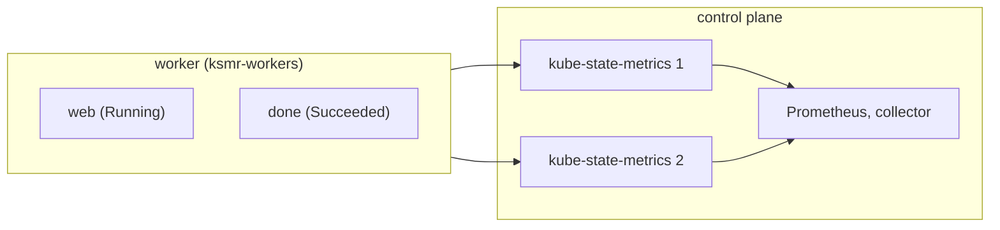

# ksm-replicas

Proves the collector reports one value per container, quota and node when two kube-state-metrics replicas hold duplicate series.
Read this to find what a duplicate-series failure means or to add a metric that a replica pair could double.

Code: [`test_ksm_replicas.py`](../../scenarios/ksm-replicas/test_ksm_replicas.py), [`workload.yaml`](../../scenarios/ksm-replicas/workload.yaml)

## Purpose

- With two kube-state-metrics replicas, every kube-state-metrics series exists twice in Prometheus,
  differing only in `instance`. Each container's CPU request series and attribute are still reported once.
- A quota's `requests.cpu` usage is reported once, not summed over both copies.
- Power state is correct when the duplicates cover a running container and a terminated one.
- Node request totals stay correct, and the node reservation percent does not divide by allocatable
  that was summed over both scrape targets.

## Setup

| Item | Value |
| --- | --- |
| Cluster | 1 control plane (`stack-e2e-system=system`, runs the stack) + 1 worker in node group `ksmr-workers` (`topology.kubex.ai/node-group`). The chart's `kube-state-metrics` is set to `replicas: 2`. |
| Workloads | `ksmr-workload` with quota `ksmr-quota` (hard `requests.cpu: 1`, no other key): Deployment `web` (container `app`, 250m CPU request) and Job `done` (container `work`, 125m request, exits 0 before the window). Both are pinned to the worker. |
| Fixtures | none |
| Collector settings | `Collection(interval="minutes", interval_size=1, history=1, sample_rate=1)`, `node_group_list=label_topology_kubex_ai_node_group`. Node exporter, GPU process exporter, Beyla, node labeler and the ephemeral-storage exporter are disabled. |
| Window | 180 s |
| Readiness gates | `ksm-twice` (2 nodes each seen by both replicas), `done-succeeded`, `quota-used` (`requests.cpu` equals `QUOTA_USED_CPU`). Lifecycle waits for `web` to be available and `done` to complete. |
| Snapshots | `resourcequotas` |



The quota sets only `requests.cpu`, so Kubernetes reports its usage under one key. `done` has finished
and released its quota share, so the used value is `web`'s 0.25 CPU.

## What the collector collects

### container/, rq/ and node/ values from kube-state-metrics

The collector reads `kube_pod_container_resource_requests` (CPU, cores), `kube_pod_status_phase`,
`kube_resourcequota` (`type="used"`) and, for nodes, the pods placed on them and `kube_node_status_allocatable`.
With two replicas each series exists twice, differing only in `instance`. The collector must collapse
them, so each container, quota and node has one row per `MetricTime`. CPU in the series files is in
mcores. A terminated container has no request and its power state is `Terminated`.

Input: `web` (Running, 250m request) and `done` (Succeeded, 125m request), quota `ksmr-quota` used
`requests.cpu` 0.25.

```csv
file,EntityName,ContainerName,column,value
container/attributes.csv,web,app,CpuRequest / PowerState,250 / Running
container/attributes.csv,done,work,CpuRequest / PowerState,(empty) / Terminated
container/cpu_request.csv,web,app,CpuRequest,250
rq/cpu_requests.csv,(quota ksmr-quota),,CpuRequests,250
```

`container/cpu_request.csv` has no `done` rows. The doubled series must not give 500 for `web` or for the
quota. For `node/cpu_reservation_percent.csv`, the worker's value is its requests over its own allocatable
(from the oracle), not over allocatable summed across both scrape targets.

## Truth sources

| Source | Used for |
| --- | --- |
| Kubernetes snapshots (`run.snapshots`, `oracle.primary`) | `web` and `done` pod specs and phases, kube-state-metrics pods running, `ksmr-quota` `status.used` |
| Oracle (`oracle.requests` / `reservation_percent`, `cpu`) | Worker CPU request and reservation percent |
| Fixture series | none |

## Tests

### Premise (the cluster is what the expectations assume)

| Test | Asserts | Truth | A failure means |
| --- | --- | --- | --- |
| `test_kube_state_metrics_runs_twice` | Two Running kube-state-metrics pods in every snapshot | snapshot | The duplicates never existed, so the tests below prove nothing. Fix the setup. |

### container/

| Test | Asserts | Truth | A failure means |
| --- | --- | --- | --- |
| `test_container_cpu_request_attribute` | One `container/attributes.csv` row each for `web/app` and `done/work`. `CpuRequest` is the spec value in mcores for `web` and empty for the terminated `done`. | snapshot | A container is duplicated, or a terminated container keeps a request |
| `test_container_cpu_request_series` | `container/cpu_request.csv` has one identity, `web/app`, on every grid step, with the spec value in mcores | snapshot, grid | Duplicate series produce extra rows or doubled values |
| `test_power_state` | `Running` for `web`, `Terminated` for `done`, one row each | snapshot | Duplicate series corrupt the power state |

### rq/

| Test | Asserts | Truth | A failure means |
| --- | --- | --- | --- |
| `test_quota_cpu_requests_series` | `rq/cpu_requests.csv` holds one `ksmr-quota` identity on every grid step, equal to `status.used` for `requests.cpu` in mcores | snapshot, grid | Quota usage is doubled or duplicated |

### node/

| Test | Asserts | Truth | A failure means |
| --- | --- | --- | --- |
| `test_worker_cpu_series` | `node/cpu_request.csv` and `cpu_reservation_percent.csv` for the worker have exactly one row per grid step, equal to the oracle | oracle, grid | Request totals or reservation percent are inflated by the second replica |

## Not covered

- `NodeTaints` after a kube-state-metrics restart or a taint change in the window. A restart can add a
  second series per taint. The suite does not change the cluster in the window.
- `HpaTargetMetrics` after a restart, for the same reason. This scenario has no HPA.

## Extend

- **New duplicated metric.** Add an entity to `workload.yaml` and to `CONTAINERS`, then a test that reads
  the file where the metric lands. Keep the quota on a single resource key. If the entity requests CPU
  in `ksmr-workload`, update `QUOTA_USED_CPU`.
- **New file.** Add it to `RQ_FILES`.
- Follow [extending.md](../extending.md) for the general steps.
