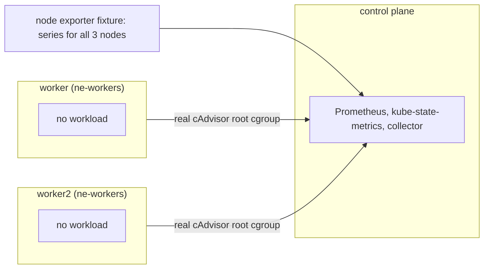

# node-exporter

Proves every node, node group and cluster file fed by node exporter series matches known fixture values, with filtered devices ignored and the control plane left out of the group.
Read this to find what a `node/`, `node_group/` or `cluster/` usage file failure means.

Code: [`test_node_exporter.py`](../../scenarios/node-exporter/test_node_exporter.py)

## Purpose

- CPU, memory, disk, network, OOM kill and CPU throttle files hold the values the node exporter series
  imply. Each node has different rates, so a mix-up between nodes shows.
- Node group files combine only the two workers. Cluster files combine all three nodes, control plane
  included. Each family declares how it combines (sum, mean, or node level only).
- Devices the collector filters out are served with rates far above the real ones: a `dm-0` disk, a
  `veth` NIC with a huge link speed, and the loopback. A missing filter changes the totals or the speed.
- Working-set utilization divides by Kubernetes allocatable memory, not by the exporter's `MemTotal`.
- The collector detects the exporter (a missing exporter fails `test_expected_files`) and records each node's maximum network speed.

## Setup

| Item | Value |
| --- | --- |
| Cluster | 1 control plane (`stack-e2e-system=system`, runs the stack, in no node group) + 2 workers in node group `ne-workers` (`topology.kubex.ai/node-group`). |
| Workloads | none. Container files come from system pods. |
| Fixtures | `kubex-prometheus-node-exporter`: stands in for the chart's node exporter of the same name (the chart's copy is disabled). Serves CPU, memory, disk, NIC, OOM and throttle series for all three nodes, each with a `node` label. Rates scale per node with `SCALE` (1, 2, 4). |
| Collector settings | `Collection(interval="minutes", interval_size=1, history=1, sample_rate=1)`, `node_group_list=label_topology_kubex_ai_node_group`. Beyla, GPU process exporter, node labeler and the ephemeral-storage exporter are disabled. Real cAdvisor stays on. |
| Window | 240 s, because the collector queries `increase(...[1m20s])` |
| Readiness gates | `exporter-node-labels` (3), `exporter-cpus` (6), `group-labels` (2), `root-working-set` (3), `allocatable-memory` (3) |
| Snapshots | nodes and pods only |



The fixture's decoys (`DISK_DECOY`, `NIC_DECOY`, `NIC_DECOY_SPEED`, `LOOPBACK`) are the same on every
node and are not scaled.

## What the collector collects

### node/, node_group/ and cluster/ exporter files

The collector reads `node_cpu_seconds_total`, `node_memory_*_bytes`, `node_disk_*_total`,
`node_network_*_total` (excluding `dm-.*` disks, `veth.*` NICs and the loopback), `node_vmstat_oom_kill`
and `node_cpu_core_throttles_total`, attributed to nodes by the `node` label. Node files hold one row
per node. Group and cluster files combine node values, by sum or mean depending on the family.
Memory is in bytes and utilization in percent. Disk and network columns are per-second rates. The OOM
and throttle files count events in the 60 s sample.

Input: worker has 2 CPUs at 40 % user + 10 % system and 20 % + 10 % (idle is the rest), 16 GiB total and
5 GiB free memory. worker2 has 32 GiB total and 12 GiB free. The control plane has 8 GiB total and 2 GiB
free. worker disks read 100000 B/s (vda) and 50000 B/s (vdb), doubled by `SCALE`.

```csv
file,NodeName / NodeGroupName / Name,value
node/memory_raw_bytes.csv,worker,11811160064
node/memory_raw_bytes.csv,control-plane,6442450944
node_group/memory_raw_bytes.csv,ne-workers,33285996544
cluster/memory_raw_bytes.csv,node-exporter,39728447488
node/cpu_utilization.csv,worker,40
node/disk_read_bytes.csv,worker,300000
node/oom_kill_events.csv,worker,6
```

`memory_raw_bytes` is total minus free: 11 GiB for worker, 31 GiB for the two workers, 37 GiB for all three.
Disk read for worker is (100000 + 50000) x 2, and `dm-0` is not in it. The OOM count is the fixture
rate (0.05 per second x `SCALE`) over 60 s.

### node/config.csv and node/attributes.csv network speed

The collector takes the last `node_network_speed_bytes` sample of the node's real NICs, truncated to an
integer. The decoy `veth` speed is larger and must lose.

```csv
NodeName,HwMaxNetworkIoBps,NetworkSpeed
worker,1250000000,1250000000
```

### node/memory_ws.csv and memory_ws_utilization.csv

The working set is the real cAdvisor root cgroup (`container_memory_working_set_bytes{id="/"}`).
Utilization is that over the node's Kubernetes allocatable memory, in percent.

## Truth sources

| Source | Used for |
| --- | --- |
| Kubernetes snapshots (`oracle.primary`) | Node allocatable memory |
| Oracle | Not used for totals |
| Fixture series (`CPU`, `MEMORY`, `SPEED`, `DISKS`, `NICS`, `OOM_KILLS`, `THROTTLES`, `SCALE`) | Every exporter value. `FAMILIES` maps each file to a formula and a combine rule. |

## Tests

### node/, node_group/ and cluster/ exporter files

Both tests below run once per file. `EXPORTER_FILES` has 51 files, the `FAMILIES` files at each level plus
`node/memory_ws.csv` and `node/memory_ws_utilization.csv`.

| Test | Asserts | Truth | A failure means |
| --- | --- | --- | --- |
| `test_exporter_series_follow_the_collector_grid` | Node files hold the three nodes, group files `ne-workers` only, cluster files one row, each on every grid step | grid | A node is missing or extra, the control plane leaks into a group, or steps are missing |
| `test_values_match_the_fixture` | Every row of the 49 fixture-valued files equals the value `FAMILIES` computes for its node, group or cluster | fixture | Wrong value, unit, device filter or node combination |

Tolerances are the named constants `RATE` (counter rates, 1 % for scrape jitter), `EXACT` (gauges and
ratios) and `COUNT` (event counts, exact whole numbers).

### node/ network and memory

| Test | Asserts | Truth | A failure means |
| --- | --- | --- | --- |
| `test_node_network_speed_and_memory_total` | `HwMaxNetworkIoBps` in `node/config.csv` and `NetworkSpeed` in `node/attributes.csv` equal each node's `eth0` speed | fixture | Wrong speed source, or the `veth` decoy wins the maximum |
| `test_working_set_utilization_uses_allocatable_memory` | `MemoryWsUtilization` equals `MemoryWs` over Kubernetes allocatable memory, in percent | snapshot, archive | Utilization uses the exporter's `MemTotal` or another denominator |

## Not covered

- Whether loopback traffic belongs in the network totals is for the collector team to decide. The suite
  expects it excluded and serves `lo` to check that.
- A collector configured for several clusters. Each run has one, so the reclaimable-memory adjustment
  in the `memory_actual_*` files is not checked across clusters.
- `MemoryWs` values come from real cAdvisor, which has no independent truth. Their grid is checked, and
  `MemoryWsUtilization` is checked against them.

## Extend

- **New family.** Add a row to `FAMILIES` with its formula and combine rule (`None` for node-only), and
  the series to `_node_exporter_series`. `CASES` and `EXPORTER_FILES` follow, and the length assert needs
  updating.
- **New node.** Add it to `CLUSTER_SPEC` and to `SCALE`, `CPU`, `MEMORY` and `SPEED`, and update the
  readiness counts.
- Follow [extending.md](../extending.md) for the general steps.
