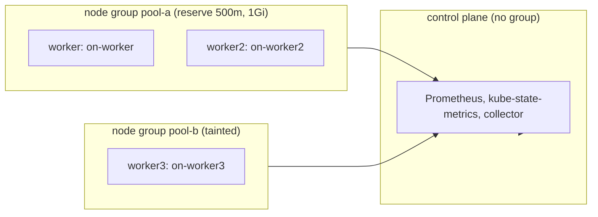

# node-pressure

Proves the collector's node, node group and cluster requests, limits, capacity, allocatable, taints, labels and reservation percent match Kubernetes when kubelets reserve resources.
Read this to find what a `node/`, `node_group/` or `cluster/` failure means. Other scenarios reuse these files as their base set.

Code: [`test_node_pressure.py`](../../scenarios/node-pressure/test_node_pressure.py), [`workload.yaml`](../../scenarios/node-pressure/workload.yaml)

## Purpose

- Node request, limit, pod count and reservation percent files equal the sums Kubernetes reports. Each
  worker runs one pod with different requests and limits, so a node mix-up shows.
- Reservation percent is requests over allocatable, which is below capacity on reserving nodes. Allocatable
  CPU is fractional (3.5 of 4 cores) and must not be rounded to whole cores.
- Node group files group nodes by the `topology.kubex.ai/node-group` label. Request series are in cores,
  attributes and config use their own units.
- Node attributes carry taints, labels, region, zone, capacity and allocatable (including huge pages) as
  Kubernetes reports them. The workers carry one region and a zone per pool, the control plane neither.
- Cluster files cover every node, control plane included.

## Setup

| Item | Value |
| --- | --- |
| Cluster | 1 control plane (`stack-e2e-system=system`, runs the stack) + 3 workers. `worker` and `worker2` are in node group `pool-a` and set kubelet `system-reserved: cpu=500m,memory=1Gi`. `worker3` is in `pool-b`, tainted `stack-e2e.kubex.ai/dedicated=pressure:NoSchedule`, with no reservation. Each node has a `node.kubernetes.io/instance-type` label (`e2e.pool-a`, `e2e.pool-b`, `e2e.system`). Workers also carry `topology.kubernetes.io/region=e2e-region` and `topology.kubernetes.io/zone` (`e2e-zone-a` for `pool-a`, `e2e-zone-b` for `pool-b`). |
| Workloads | `node-pressure-workload`: bare Pods `on-worker` (300m / 256Mi request, 600m / 512Mi limit), `on-worker2` (500m / 384Mi, 800m / 768Mi) and `on-worker3` (700m / 512Mi, 1500m / 1Gi, tolerates the taint). Each is pinned to its worker by hostname. |
| Fixtures | none |
| Collector settings | `Collection(interval="minutes", interval_size=1, history=1, sample_rate=1)`, `node_group_list=label_topology_kubex_ai_node_group`. Node exporter, GPU process exporter, Beyla, node labeler and the ephemeral-storage exporter are disabled. |
| Window | 180 s |
| Readiness gates | `pool-labels` (3), `dedicated-taint` (1), `node-allocatable-resources` (8), `workload-cpu-requests`, `workload-memory-requests`, `workload-cpu-limits`, `workload-memory-limits` (3 each). Lifecycle waits for the three pods to be Ready. |
| Snapshots | nodes and pods only |



Node requests also include the system pods that run on each node (for example on the control plane), so
expected totals come from the oracle, not from `workload.yaml` alone.

## What the collector collects

### node/ requests, limits and reservation

The collector reads `kube_pod_container_resource_requests` and `_limits` (cpu, memory) for running pods
by node, and `kube_node_status_allocatable`. A node has a row only when it has a request, limit or pod.
CPU is in mcores and memory in MiB. Reservation percent is requests over allocatable, in percent.

Input: `worker` has capacity 4000 mcores, allocatable 3500, and requests 400 mcores (300 from
`on-worker`, the rest from system pods) and 600 mcores of limits.

```csv
NodeName,CpuRequest,CpuLimit,CpuReservationPercent,MemoryRequest
worker,400,600,11.43,306
```

### node_group/ membership and totals

Nodes with the same `label_topology_kubex_ai_node_group` value form one group. Nodes without the label
(the control plane here) are in none. Group request series are in cores and MiB. Group attributes hold
whole mcores and MiB, `CurrentNodes` joined with `|`, and `CurrentSize`.

Input: `worker` and `worker2` carry `pool-a`, `worker3` carries `pool-b`, the control plane has none.

```csv
NodeGroupName,CurrentSize,CurrentNodes,cpu_requests (cores),memory_requests (MiB),CpuRequest (attr, mcores)
pool-a,2,worker|worker2,1.0,740,1000
pool-b,1,worker3,0.8,562,800
```

The cluster files add the control plane: `cluster/cpu_requests.csv` is 2.95 cores.

## Truth sources

| Source | Used for |
| --- | --- |
| Kubernetes snapshots (`run.snapshots`, `oracle.primary`) | Node spec and status: capacity, allocatable, taints, labels, `nodeInfo`, provider ID |
| Oracle (`oracle.requests` / `limits` / `capacity` / `reservation_percent` / `pod_count`) | Node, group and cluster totals and percentages. Node selectors: hostname, group label, `kubernetes.io/os=linux`. |
| Fixture series | none |

## Tests

### Premise (the cluster is what the expectations assume)

| Test | Asserts | Truth | A failure means |
| --- | --- | --- | --- |
| `test_reserved_workers_have_less_allocatable_than_capacity` | `pool-a` workers lose exactly 0.5 CPU and 1Gi more than the `pool-b` worker | snapshot | The reservation did not apply. Reservation tests cannot tell capacity from allocatable. |
| `test_workers_have_distinct_requests_and_limits` | The three workers differ in request and limit sums | oracle | A node mix-up in the collector would go unnoticed |

### node/

| Test | Asserts | Truth | A failure means |
| --- | --- | --- | --- |
| `test_every_node_is_described_once` | `node/config.csv` and `attributes.csv` hold one row per node | snapshot | A node is missing or duplicated |
| `test_node_series_follow_the_collector_grid` | Seven node series (requests, limits, reservation percent, pod count) have the nodes that report them on every grid step | oracle, grid | A node row is missing, extra or has missing steps |
| `test_node_series_match_the_cluster` | CPU in mcores, memory in MiB, percent to two decimals, pod count | oracle | Wrong total, unit or denominator |
| `test_node_config_hardware` | `HwTotalCpus`, `HwTotalPhysicalCpus`, fixed cores and threads, `HwTotalMemory` in MiB | snapshot | Wrong capacity or unit |
| `test_node_config_os_name` | `OsName` equals `nodeInfo.operatingSystem` | snapshot | Wrong OS |
| `test_node_config_model_and_network` | `HwModel` is the instance-type label, `HwMaxNetworkIoBps` is blank without a node exporter | snapshot | Wrong model source |
| `test_node_attributes_identify_the_node` | `VirtualTechnology`, `VirtualDomain`, `VirtualDatacenter` (region label), `VirtualCluster` (zone label), `OsArchitecture`, `ProviderId`, `K8sVersion` | snapshot | Node identity wrong, or region and zone swapped or dropped |
| `test_node_attribute_requests_and_limits` | Whole mcores and MiB, truncated | oracle | Wrong rounding or unit |
| `test_node_attribute_capacity_and_allocatable` | Pods, CPU (mcores and cores), memory, ephemeral storage and 2Mi huge pages, capacity and allocatable, as Kubernetes reports | snapshot | Wrong capacity or allocatable |
| `test_node_attribute_taints` | `NodeTaints` equals the node's taints | snapshot | Taints lost or misformatted |
| `test_node_attribute_labels` | Every `label_*` entry in `NodeLabels` equals a Kubernetes node label | snapshot | Labels lost or changed |

### node_group/

| Test | Asserts | Truth | A failure means |
| --- | --- | --- | --- |
| `test_node_groups_are_exactly_the_two_pools` | `node_group/config.csv` and `attributes.csv` hold `pool-a` and `pool-b` once each | snapshot | A group is invented, missing or duplicated, or the control plane forms one |
| `test_node_group_series_follow_the_collector_grid` | Five group series have both groups on every grid step | grid | Missing group or steps |
| `test_node_group_membership` | `VirtualTechnology` is `NodeGroup`, `CurrentNodes` and `CurrentSize` match the labelled nodes | snapshot | Wrong membership |
| `test_current_size_holds_for_every_sample` | `current_size.csv` equals the member count at every step | snapshot | Size changes or is wrong |
| `test_group_requests_match_the_cluster` | Group requests in cores and MiB | oracle | Wrong group total |
| `test_group_reservation_percent_matches_the_cluster` | Group reservation percent | oracle | Wrong denominator over the members |
| `test_group_attribute_requests_and_limits` | Whole mcores and MiB, truncated | oracle | Wrong rounding or unit |
| `test_group_config_hardware` | CPU count, and `HwTotalMemory` as the raw byte sum over members (not MiB) | oracle | Wrong capacity or unit |
| `test_group_config_os_and_model` | `OsName` and `HwModel` equal the members' shared labels | snapshot | Wrong group metadata |
| `test_group_attribute_labels` | Labels all members share appear in `NodeLabels` with their value | snapshot | Shared labels lost or wrong |

### cluster/

| Test | Asserts | Truth | A failure means |
| --- | --- | --- | --- |
| `test_cluster_is_described_once` | One row in `cluster/config.csv` and `attributes.csv` | snapshot | Cluster duplicated or missing |
| `test_cluster_attributes_match_the_cluster` | `VirtualTechnology`, whole mcores and MiB for requests and limits, `K8sVersion` | oracle, snapshot | Wrong cluster total or version |
| `test_cluster_series_follow_the_collector_grid` | Four cluster series have one row per grid step | grid | Missing or extra steps |
| `test_cluster_requests_match_the_cluster` | Cluster requests in cores and MiB | oracle | Wrong total |
| `test_cluster_reservation_percent_matches_the_cluster` | Cluster reservation percent | oracle | Wrong denominator |

## Extend

- **New node or group.** Add it to `ClusterSpec` and, for a new group, to `GROUPS`. Pin a pod to it in
  `workload.yaml` and update the `pool-labels` and `node-allocatable-resources` readiness counts.
- **New pod.** Give it distinct requests and limits and update the `workload-*` readiness counts.
- Follow [extending.md](../extending.md) for the general steps.
