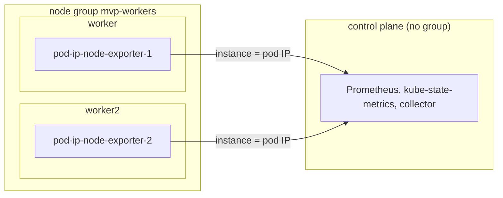

# nodegroup-labels

Proves that a node exporter scraped by pod IP (no `node` label) is attributed to its node, and that node, group and cluster usage files hold the per-node fixture values.
Read this to find what a pod-IP exporter failure means. Label-derived group membership and totals are covered by [node-pressure](node-pressure.md) and [nodegroup-roles](nodegroup-roles.md).

Code: [`test_nodegroup_labels.py`](../../scenarios/nodegroup-labels/test_nodegroup_labels.py)

## Purpose

- A node exporter scraped like kube-prometheus-stack does (no `node` label, `instance` is the pod IP and
  port) is attributed to the node the serving pod runs on. Node, group and cluster usage files hold the
  per-node fixture values.
- The group and cluster files combine the workers the same way as with a labelled exporter: CPU utilization
  is averaged over nodes, memory bytes are summed, and the control plane (no exporter) does not count.
- Working-set series cover every node, control plane included.

## Setup

| Item | Value |
| --- | --- |
| Cluster | 1 control plane (`stack-e2e-system=system`, runs the stack, no group label) + 2 workers, both labelled `topology.kubex.ai/node-group=mvp-workers`. |
| Workloads | none beyond the stack |
| Fixtures | `pod-ip-node-exporter-1` and `-2`: node exporter series for `worker` and `worker2` (CPU, memory), each pod pinned to its worker. Series carry no `node` label. An extra Prometheus scrape job `pod-ip-node-exporter` (pod role, namespace `kubex`) scrapes them. |
| Collector settings | `Collection(interval="minutes", interval_size=1, history=1, sample_rate=1)`, `node_group_list=label_topology_kubex_ai_node_group`. The chart's node exporter, GPU process exporter, Beyla, node labeler and the ephemeral-storage exporter are disabled. |
| Window | 180 s |
| Readiness gates | `exporter-without-node` (2), `exporter-pods` (2), `mvp-worker-labels` (2), `node-allocatable-resources` (2) |
| Snapshots | nodes and pods only |



## What the collector collects

### Pod-IP node exporter series

Without a `node` label the collector maps `instance` (pod IP and port) to the exporter pod's IP in
`kube_pod_info`, then to that pod's node. Memory is in bytes, CPU utilization in percent.

Input: worker has 2 CPUs at 40 % + 10 % and 20 % + 10 % (user + system) and 16 GiB total, 5 GiB free.
worker2 has 60 % average CPU and 32 GiB total, 12 GiB free.

```csv
file,NodeName / NodeGroupName / Name,CpuUtilization,MemoryBytes
node/*,worker,40,11 GiB
node/*,worker2,60,20 GiB
node_group/*,mvp-workers,50,31 GiB
cluster/*,nodegroup-labels,50,31 GiB
```

CPU utilization is averaged over the nodes. `MemoryBytes` is total minus free and is summed. The
control plane has no exporter, so it does not count in the group or the cluster.

## Truth sources

| Source | Used for |
| --- | --- |
| Kubernetes snapshots (`run.snapshots`) | Exporter pod placement and pod IPs |
| Fixture series (`EXPORTER_CPU`, `EXPORTER_MEMORY`, `FAMILIES`) | Node, group and cluster exporter values. `HAND` holds the hand-computed numbers. |
| Collector grid (`expected_timestamps`) | `MetricTime` steps of every series |

## Tests

### Premise (the cluster is what the expectations assume)

| Test | Asserts | Truth | A failure means |
| --- | --- | --- | --- |
| `test_pod_ip_exporters_run_on_their_nodes` | Each exporter fixture has one Running pod on its worker with a pod IP, in every snapshot | snapshot | Series cannot be mapped to a node. Exporter tests prove nothing. |

### Pod-IP node exporter

| Test | Asserts | Truth | A failure means |
| --- | --- | --- | --- |
| `test_pod_ip_exporter_series` | 11 files (`node/`, `node_group/`, `cluster/` CPU and memory families) hold the expected identities on the grid with the fixture values | fixture, grid | Series without a `node` label are dropped, attributed to the wrong node, or combined wrongly |
| `test_working_set_series_follow_the_collector_grid` | `node/memory_ws.csv` and `memory_ws_utilization.csv` hold all three nodes on the grid (real cAdvisor, so identities only) | grid | A node is missing from working-set series |

## Not covered

- Node names that contain one another (`worker`, `worker2`) in one group. The collector skips a name found
  inside another, so the size can depend on the order it sees the nodes. Kind's names arrive in the
  order that hides it, and the suite does not vary the order.

## Extend

- **New worker.** Add it to `CLUSTER_SPEC`, give it a pinned exporter fixture in `EXPORTERS` and
  `EXPORTER_CPU` / `EXPORTER_MEMORY`, and update `IDENTITIES`, `HAND` and the readiness counts.
- **New exporter family.** Add it to `FAMILIES`, `EXPORTER_FILES` and `HAND`.
- Follow [extending.md](../extending.md) for the general steps.
