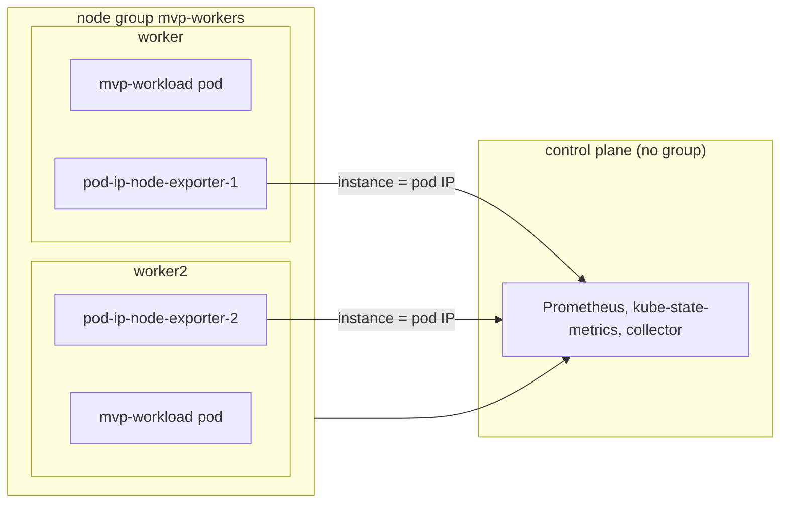

# nodegroup-labels

Proves label-derived node group membership and totals, and that a node exporter scraped by pod IP (no `node` label) maps to its node.
Read this to find what a `node_group/` failure means for a label-grouped cluster, or what a pod-IP exporter failure means.

Code: [`test_nodegroup_labels.py`](../../scenarios/nodegroup-labels/test_nodegroup_labels.py), [`workload.yaml`](../../scenarios/nodegroup-labels/workload.yaml)

## Purpose

- Nodes that share the configured group label form one node group. The collector is configured with
  `node_group_list=label_topology_kubex_ai_node_group`, so a second label on the same nodes
  (`ignored.kubex.ai/group`) must not create another group.
- The group's membership, size, requests, limits, capacity and reservation percent match Kubernetes.
  The control plane has no group label and is in no group.
- A node exporter scraped like kube-prometheus-stack does (no `node` label, `instance` is the pod IP and
  port) is attributed to the node the serving pod runs on. Node, group and cluster usage files hold the
  per-node fixture values.
- Working-set series cover every node, control plane included.

## Setup

| Item | Value |
| --- | --- |
| Cluster | 1 control plane (`stack-e2e-system=system`, runs the stack, no group label) + 2 workers, both labelled `topology.kubex.ai/node-group=mvp-workers` and `ignored.kubex.ai/group=ignored-value`. |
| Workloads | `nodegroup-labels-workload`: Deployment `mvp-workload` (2 replicas, container `workload`, 100m / 64Mi request, 200m / 128Mi limit), selected onto `mvp-workers` and spread one per node by a topology spread constraint. |
| Fixtures | `pod-ip-node-exporter-1` and `-2`: node exporter series for `worker` and `worker2` (CPU, memory), each pod pinned to its worker. Series carry no `node` label. An extra Prometheus scrape job `pod-ip-node-exporter` (pod role, namespace `kubex`) scrapes them. |
| Collector settings | `Collection(interval="minutes", interval_size=1, history=1, sample_rate=1)`, `node_group_list=label_topology_kubex_ai_node_group`. The chart's node exporter, GPU process exporter, Beyla, node labeler and the ephemeral-storage exporter are disabled. |
| Window | 180 s |
| Readiness gates | `exporter-without-node` (2), `exporter-pods` (2), `mvp-worker-labels` (2), `node-allocatable-resources` (2), `workload-cpu-requests`, `workload-memory-requests`, `workload-cpu-limits`, `workload-memory-limits` (2 each). Lifecycle waits for `mvp-workload`. |
| Snapshots | nodes and pods only |



## What the collector collects

### node_group/ membership and totals

The collector reads `kube_node_labels` and groups nodes by the configured label value. Group request
series are in cores and MiB, and attributes hold whole mcores and MiB. `HwTotalMemory` in
`node_group/config.csv` is the raw byte sum of node capacity.

Input: `worker` and `worker2` carry `mvp-workers`, and the control plane carries no group label.

```csv
NodeGroupName,CurrentSize,CurrentNodes,CpuRequests (cores),HwTotalCpus
mvp-workers,2,worker|worker2,0.4,8
```

There is no row for the control plane and none for the ignored label. `CpuRequests` here also counts the
system pods on the two workers, in addition to the 0.2 cores of `mvp-workload`.

### Pod-IP node exporter series

Without a `node` label the collector maps `instance` (pod IP and port) to the exporter pod's IP in
`kube_pod_info`, then to that pod's node. Memory is in bytes, CPU utilization in percent.

Input: worker has 2 CPUs at 40 % + 10 % and 20 % + 10 % (user + system) and 16 GiB total, 5 GiB free.
worker2 has 60 % average CPU and 32 GiB total, 12 GiB free.

```csv
file,NodeName / NodeGroupName / Name,CpuUtilization,MemoryBytes
node/*,worker,40,11 GiB
node/*,worker2,60,20 GiB
node_group/*,mvp-workers,50,31 GiB
cluster/*,nodegroup-labels,50,31 GiB
```

CPU utilization is averaged over the nodes. `MemoryBytes` is total minus free and is summed. The
control plane has no exporter, so it does not count in the group or the cluster.

## Truth sources

| Source | Used for |
| --- | --- |
| Kubernetes snapshots (`run.snapshots`, `oracle.primary`) | Node names, OS, exporter pod placement and pod IPs |
| Oracle (`oracle.requests` / `limits` / `capacity` / `reservation_percent` with the group label selector) | Group requests, limits, capacity and reservation percent |
| Fixture series (`EXPORTER_CPU`, `EXPORTER_MEMORY`, `FAMILIES`) | Node, group and cluster exporter values. `HAND` holds the hand-computed numbers. |
| Collector grid (`expected_timestamps`) | `MetricTime` steps of every series |

## Tests

### Premise (the cluster is what the expectations assume)

| Test | Asserts | Truth | A failure means |
| --- | --- | --- | --- |
| `test_pod_ip_exporters_run_on_their_nodes` | Each exporter fixture has one Running pod on its worker with a pod IP, in every snapshot | snapshot | Series cannot be mapped to a node. Exporter tests prove nothing. |

### node_group/ shape and membership

| Test | Asserts | Truth | A failure means |
| --- | --- | --- | --- |
| `test_cluster_and_group_identity_is_the_only_one` | Seven group files hold only the cluster and `mvp-workers` | snapshot | The ignored label or the control plane created a group |
| `test_entity_tables_hold_exactly_one_row` | `config.csv` and `attributes.csv` have one unique row | snapshot | Group duplicated or missing |
| `test_time_series_follow_the_collector_grid` | Five group series have one identity on every grid step | grid | Missing steps or identities |
| `test_both_workers_are_in_the_group` | `CurrentNodes` is both workers, `CurrentSize` is 2 | snapshot | Members missing, or the control plane included |
| `test_attributes_describe_a_node_group` | `VirtualTechnology` is `NodeGroup`, `VirtualDomain` the cluster | snapshot | Wrong entity type or domain |
| `test_current_size_holds_for_every_sample` | `current_size.csv` is 2 at every step | snapshot | Size drifts or is wrong |

### node_group/ values

| Test | Asserts | Truth | A failure means |
| --- | --- | --- | --- |
| `test_requests_match_the_cluster` | `cpu_requests.csv` in cores, `memory_requests.csv` in MiB | oracle | Wrong group total or unit |
| `test_reservation_percent_matches_the_cluster` | CPU and memory reservation percent | oracle | Wrong denominator |
| `test_attribute_cpu_request`, `test_attribute_memory_request`, `test_attribute_cpu_limit`, `test_attribute_memory_limit` | Whole mcores and MiB, truncated | oracle | Wrong rounding or unit |
| `test_config_total_cpus` | `HwTotalCpus` equals the members' CPU capacity | oracle | Wrong capacity |
| `test_config_total_memory_in_bytes` | `HwTotalMemory` is the raw byte sum, not MiB | oracle | Wrong unit or total |
| `test_config_os_name` | `OsName` equals the members' operating system | snapshot | Wrong OS |

### Pod-IP node exporter

| Test | Asserts | Truth | A failure means |
| --- | --- | --- | --- |
| `test_pod_ip_exporter_series` | 11 files (`node/`, `node_group/`, `cluster/` CPU and memory families) hold the expected identities on the grid with the fixture values | fixture, grid | Series without a `node` label are dropped, attributed to the wrong node, or combined wrongly |
| `test_working_set_series_follow_the_collector_grid` | `node/memory_ws.csv` and `memory_ws_utilization.csv` hold all three nodes on the grid (real cAdvisor, so identities only) | grid | A node is missing from working-set series |

## Not covered

- Node names that contain one another (`worker`, `worker2`) in one group. The collector skips a name found
  inside another, so the size can depend on the order it sees the nodes. Kind's names arrive in the
  order that hides it, and the suite does not vary the order.
- Several configured group labels, or equal values under different labels. One label is configured, so
  group identity across labels is not checked.

## Run and replay

```sh
.venv/bin/python -m pytest scenarios/nodegroup-labels -v --tb=short
.venv/bin/python -m pytest scenarios/nodegroup-labels --replay <artifact-dir> -q --tb=short
```

## Extend

- **New worker.** Add it to `CLUSTER_SPEC`, give it a pinned exporter fixture in `EXPORTERS` and
  `EXPORTER_CPU` / `EXPORTER_MEMORY`, and update `IDENTITIES`, `HAND`, the member counts and the readiness
  counts.
- **New exporter family.** Add it to `FAMILIES`, `EXPORTER_FILES` and `HAND`.
- Coverage inventory entries reference this module through the `_NGL` prefix in
  [`harness/coverage.py`](../../harness/coverage.py).
- Follow [extending.md](../extending.md) for the general steps.
