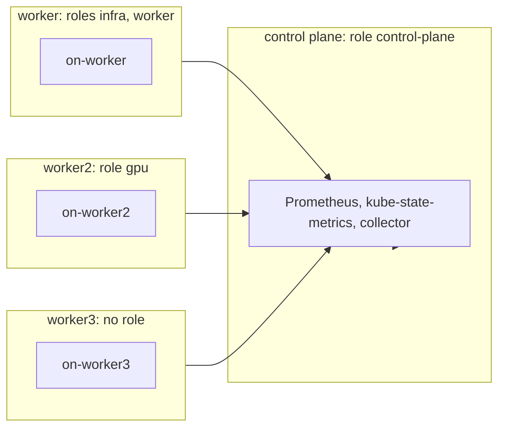

# nodegroup-roles

Proves role-derived node groups: the first configured role wins, an unconfigured role forms its own group, and a node with no role is in no group.
Read this to find what a `node_group/` failure means for a cluster that groups by node role.

Code: [`test_nodegroup_roles.py`](../../scenarios/nodegroup-roles/test_nodegroup_roles.py), [`workload.yaml`](../../scenarios/nodegroup-roles/workload.yaml)

## Purpose

- The collector runs with `role_list=control-plane,infra,worker` and no node-group label. A node joins
  the first configured role it has.
- A node with roles `infra` and `worker` is in `infra` only. `worker` is already taken, so no `worker`
  group appears.
- A node whose role is not configured (`gpu`) forms a group named after that role.
- A node with no role is in no group.
- For every group, including the ones after the first, membership, size, requests, limits, capacity,
  labels and reservation percent match Kubernetes for that group's members.

## Setup

| Item | Value |
| --- | --- |
| Cluster | 1 control plane (`stack-e2e-system=system`, runs the stack, role `control-plane`) + 3 workers. `worker`: roles `infra` and `worker`. `worker2`: role `gpu`. `worker3`: no role. Each node has an instance-type label, and `stack-e2e.kubex.ai/expect-group` marks the expected group for the oracle only. |
| Workloads | `nodegroup-roles-workload`: bare Pods `on-worker` (250m / 192Mi request, 700m / 384Mi limit), `on-worker2` (400m / 320Mi, 900m / 640Mi), `on-worker3` (600m / 448Mi, 1200m / 896Mi), each pinned to its worker by hostname. |
| Fixtures | none |
| Collector settings | `Collection(interval="minutes", interval_size=1, history=1, sample_rate=1)`, `role_list=control-plane,infra,worker`. No `node_group_list`: the chart default matches no label on Kind. Node exporter, GPU process exporter, Beyla, node labeler and the ephemeral-storage exporter are disabled. |
| Window | 180 s |
| Readiness gates | `node-roles` (4), `node-allocatable-resources` (8), `workload-cpu-requests`, `workload-memory-requests`, `workload-cpu-limits`, `workload-memory-limits` (3 each). Lifecycle waits for the three pods to be Ready. |
| Snapshots | nodes and pods only |



## What the collector collects

### node_group/ membership from roles

The collector reads `kube_node_role` and walks `role_list` in order. A node goes to the first listed role
it has. A role not in the list that a node has becomes that node's group (at most one such role is
allowed). Group requests and limits sum the members' pods: series in cores and MiB, attributes in whole
mcores and MiB.

Input: four nodes and their roles.

| Node | Roles | Group |
| --- | --- | --- |
| control-plane | `control-plane` | `control-plane` |
| worker | `infra`, `worker` | `infra` (`worker` already taken) |
| worker2 | `gpu` (not configured) | `gpu` |
| worker3 | none | none |

```csv
NodeGroupName,CurrentSize,CurrentNodes,CpuRequest (attr, mcores)
control-plane,1,control-plane,...
infra,1,worker,350
gpu,1,worker2,500
```

`worker3` appears in no `CurrentNodes`, and no group counts its pod's requests. `infra` is 250 mcores
from `on-worker` plus the system pods on `worker`.

## Truth sources

| Source | Used for |
| --- | --- |
| Kubernetes snapshots (`run.snapshots`, `oracle.primary`) | Member nodes' labels, capacity and OS |
| Oracle (`oracle.requests` / `limits` / `capacity` / `reservation_percent`, selected by `expect-group`) | Group requests, limits, capacity and reservation percent |
| Fixture series | none |

`MEMBERS` in the module maps each group to its expected node, and `UNGROUPED` is `worker3`.

## Tests

### Premise (the cluster is what the expectations assume)

| Test | Asserts | Truth | A failure means |
| --- | --- | --- | --- |
| `test_groups_have_distinct_requests_and_limits` | The three groups differ in CPU and memory request and limit sums | oracle | A group reporting another's sums or a node count would pass unnoticed |

### node_group/ shape and membership

| Test | Asserts | Truth | A failure means |
| --- | --- | --- | --- |
| `test_entity_tables_hold_exactly_the_three_groups` | `config.csv` and `attributes.csv` hold `control-plane`, `infra` and `gpu` once each. No `worker`, no default group. | `MEMBERS` | A group is invented, missing or duplicated, or a claimed role forms a group |
| `test_time_series_follow_the_collector_grid` | Five series have the three groups on every grid step | grid | Missing group or steps |
| `test_group_membership` | `VirtualTechnology` is `NodeGroup`, `CurrentNodes` and `CurrentSize` match `MEMBERS` | `MEMBERS` | Wrong membership or the wrong role wins |
| `test_current_size_holds_for_every_sample` | `current_size.csv` equals each group's member count at every step | `MEMBERS` | Size wrong or drifts |

### node_group/ values

| Test | Asserts | Truth | A failure means |
| --- | --- | --- | --- |
| `test_requests_match_the_cluster` | `cpu_requests.csv` in cores, `memory_requests.csv` in MiB, per group | oracle | Wrong group total or unit |
| `test_reservation_percent_matches_the_cluster` | CPU and memory reservation percent per group | oracle | Wrong denominator |
| `test_attribute_requests_and_limits` | `CpuRequest`, `MemoryRequest`, `CpuLimit`, `MemoryLimit` in whole mcores and MiB, truncated | oracle | Wrong rounding or unit |
| `test_config_hardware` | CPU counts, fixed cores and threads, `HwTotalMemory` as the raw byte sum | oracle | Wrong capacity or unit |
| `test_config_os_and_model` | `OsName` and `HwModel` equal the members' shared labels | snapshot | Wrong group metadata |
| `test_attribute_labels` | Labels all members share appear in `NodeLabels` with their value | snapshot | Shared labels lost or wrong |

## Not covered

- A `role_list` with exactly two entries. The scenario configures three, so the two-entry case, where a
  node with an extra role could land in two groups, is not checked.
- A node with several unconfigured roles. The collector allows one, so the case is not set up.

## Extend

- **New role case.** Add the node to `ClusterSpec` with its `roles` and `expect-group` label, a pinned
  pod in `workload.yaml`, and an entry in `MEMBERS` (or `UNGROUPED`). Update the `node-roles`,
  `node-allocatable-resources` and `workload-*` readiness counts.
- **Change `role_list`.** Edit the forwarder `config.collection.role_list` and the expected groups together.
- Follow [extending.md](../extending.md) for the general steps.
